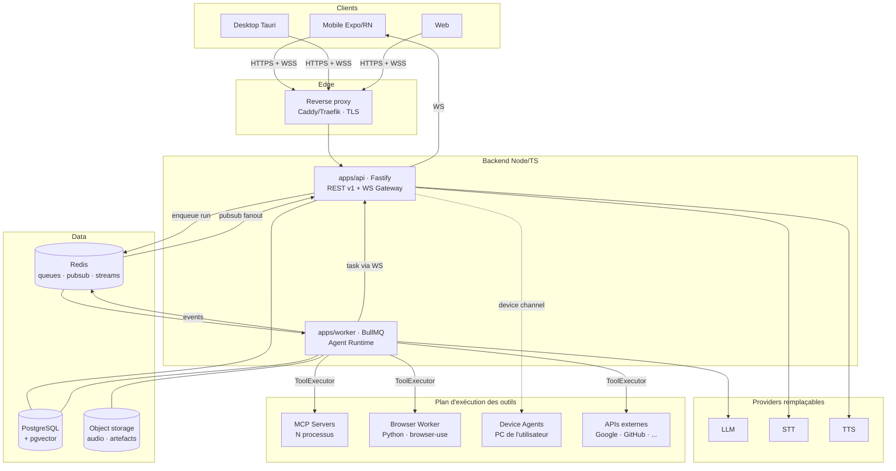

# 00 — Vue d'ensemble

## 1. Contexte

NEXUS est un assistant personnel IA **mono-utilisateur d'abord, multi-utilisateur par construction**.
Il est accessible depuis un iPhone, un PC et éventuellement un navigateur, accepte du texte
ou de la voix, répond en texte ou en voix, et — c'est le cœur du produit — **exécute des actions
réelles** : envoyer un email, réserver, lancer des tests sur le PC, piloter un navigateur.

Ce dernier point est ce qui rend le projet difficile. Un chatbot qui se trompe produit une
phrase fausse. Un agent qui se trompe supprime un fichier, envoie un email au mauvais
destinataire ou effectue un paiement. **Toute l'architecture est organisée autour de cette
asymétrie.**

## 2. Contraintes structurantes

| #   | Contrainte                                             | Conséquence architecturale                                                |
| --- | ------------------------------------------------------ | ------------------------------------------------------------------------- |
| C1  | Le LLM n'est jamais branché directement sur les outils | Une seule frontière d'exécution : `ToolExecutor`                          |
| C2  | Aucun accès implicite à un outil                       | Grant explicite par utilisateur × outil, deny par défaut                  |
| C3  | Confirmation utilisateur pour les actions sensibles    | Le run doit pouvoir **se suspendre durablement** et reprendre             |
| C4  | Aucun couplage UI ↔ outils                             | Les clients ne connaissent que l'API et le protocole WS                   |
| C5  | Providers LLM/STT/TTS interchangeables                 | Ports & adapters, aucun SDK vendeur hors des adaptateurs                  |
| C6  | Le backend TS n'importe jamais le code Python          | Browser Use = service réseau, contrat HTTP versionné                      |
| C7  | Mobile en temps réel                                   | WebSocket unique multiplexé, événements typés, reprenable                 |
| C8  | Déployable sur un VPS                                  | Docker Compose, pas de dépendance cloud managée obligatoire               |
| C9  | Aucun secret dans le code                              | Config validée par schéma, secrets injectés, credentials chiffrés en base |

## 3. Vue système



## 4. Les quatre plans

L'architecture se lit sur quatre plans qu'il faut garder mentalement séparés :

1. **Plan de conversation** — clients, API, WebSocket, messages. Ne sait rien des outils.
2. **Plan de raisonnement** — Agent Runtime, Planner, LLMProvider. Ne sait rien du _comment_
   les outils s'exécutent, seulement de leurs schémas.
3. **Plan de capacité** — ToolRegistry, adaptateurs (MCP, Browser, Device, HTTP). Ne sait rien
   du LLM.
4. **Plan de gouvernance** — permissions, confirmations, audit, budgets. Traverse les trois autres
   et peut interrompre n'importe lequel.

Une violation de cette séparation est un défaut d'architecture, pas un détail d'implémentation.

## 5. Flux de bout en bout (texte)

```
1.  Client         POST /api/v1/agent/runs { conversationId, content }
2.  API            authN (JWT) → authZ (conversation) → persiste Message(role=user)
                   → crée AgentRun(status=QUEUED) → enqueue BullMQ → 202 { runId }
3.  Client         WS: subscribe { runId }   (déjà connecté, canal unique)
4.  Worker         charge le contexte (Memory Assembler : system + prefs + résumé + fenêtre)
5.  Worker         ToolRegistry.listFor(user, conversation) → outils autorisés uniquement
6.  Worker         LLMProvider.stream(messages, tools) → tokens → Redis pubsub → WS agent.token
7.  LLM            demande tool_call { name, args }
8.  Worker         valide args (zod) → PermissionService.check()
       ├── DENY         → observation d'erreur réinjectée au modèle, boucle continue
       ├── CONFIRM      → persiste Confirmation, run → WAITING_CONFIRMATION, WS confirmation.requested
       │                  (le worker LIBÈRE le job : aucune attente bloquante)
       └── ALLOW        → ToolExecutor.execute() → WS tool.started / tool.progress / tool.result
9.  Worker         réinjecte l'observation, incrémente l'itération, vérifie les budgets, boucle
10. Worker         réponse finale → Message(role=assistant) → run COMPLETED → WS run.completed
11. Client         (si mode vocal) POST /api/v1/voice/tts → stream audio
```

Sur confirmation utilisateur (`POST /api/v1/confirmations/:id`), l'API ré-enfile un job de
**reprise** ; le worker recharge l'état persisté du run et poursuit exactement là où il s'était
arrêté. C'est la raison pour laquelle la boucle agentique est un **réducteur sur un état persisté**
et non une fonction récursive en mémoire (→ [ADR-003](../adr/ADR-003-durable-agent-loop.md)).

## 6. Ce que nous ne construisons pas (v1)

Le posé explicite de ce qui est hors périmètre est aussi important que le périmètre :

- Pas de multi-tenant B2B, pas de facturation, pas d'org/rôles complexes (le modèle prévoit
  `User` mais l'usage v1 est personnel).
- Pas de fine-tuning ni d'entraînement de modèle.
- Pas de vector DB dédiée (pgvector suffit à l'échelle d'un utilisateur → [ADR-011](../adr/ADR-011-memory-pgvector.md)).
- Pas de Kubernetes (un VPS + Compose → [ADR-015](../adr/ADR-015-deployment-compose.md)).
- Pas d'exécution de code arbitraire non sandboxée côté serveur (le terminal s'exécute sur le
  Device Agent de l'utilisateur, sous permission).
