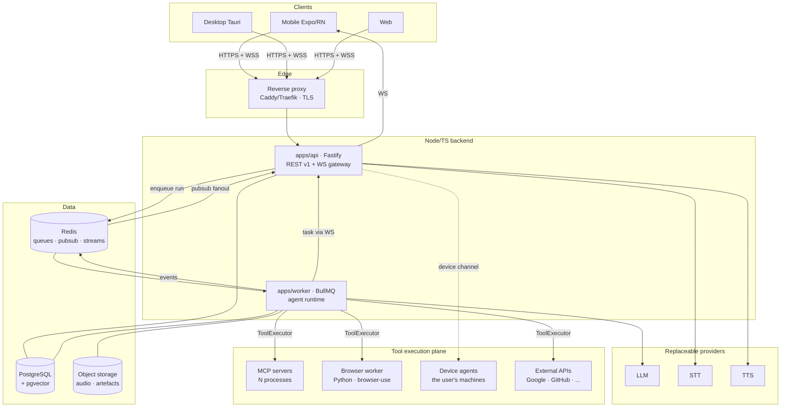

# 00 — Overview

## 1. Context

NEXUS is a personal AI assistant, **single-user first, multi-user by construction**. It is reachable
from an iPhone, a PC and optionally a browser, accepts text or voice, answers in text or voice,
and — this is the heart of the product — **carries out real actions**: send an email, make a
booking, run a project's tests on the PC, drive a browser.

That last point is what makes the project hard. A chatbot that gets it wrong produces a false
sentence. An agent that gets it wrong deletes a file, emails the wrong person, or makes a payment.
**The whole architecture is organised around that asymmetry.**

## 2. Structural constraints

| #   | Constraint                                       | Architectural consequence                                        |
| --- | ------------------------------------------------ | ---------------------------------------------------------------- |
| C1  | The model is never wired directly to tools       | One execution boundary: `ToolExecutor`                           |
| C2  | No implicit access to a tool                     | Explicit grant per user × tool, deny by default                  |
| C3  | User confirmation for sensitive actions          | A run must be able to **suspend durably** and resume             |
| C4  | No UI ↔ tool coupling                            | Clients know only the API and the WS protocol                    |
| C5  | LLM/STT/TTS providers are interchangeable        | Ports and adapters; no vendor SDK outside an adapter             |
| C6  | The TypeScript backend never imports Python code | Browser Use is a network service with a versioned HTTP contract  |
| C7  | Realtime on mobile                               | One multiplexed WebSocket, typed events, resumable               |
| C8  | Deployable on a single VPS                       | Docker Compose, no mandatory managed cloud dependency            |
| C9  | No secret in the code                            | Schema-validated config, injected secrets, credentials encrypted |

## 3. System view



## 4. The four planes

The architecture reads on four planes, and keeping them mentally separate is what makes it
comprehensible:

1. **The conversation plane** — clients, API, WebSocket, messages. Knows nothing about tools.
2. **The reasoning plane** — agent runtime, planner, `LLMProvider`. Knows nothing about _how_
   tools run, only about their schemas.
3. **The capability plane** — `ToolRegistry`, adapters (MCP, browser, device, HTTP). Knows nothing
   about the model.
4. **The governance plane** — permissions, confirmations, audit, budgets. It crosses the other
   three and can interrupt any of them.

Violating that separation is an architectural defect, not an implementation detail.

## 5. End-to-end flow (text)

```
1.  Client         POST /api/v1/agent/runs { conversationId, content }
2.  API            authN (JWT) → authZ (conversation) → persist Message(role=user)
                   → create AgentRun(status=QUEUED) → enqueue BullMQ → 202 { runId }
3.  Client         WS: subscribe { runId }   (already connected, single channel)
4.  Worker         load the context (memory assembler: system + prefs + summary + window)
5.  Worker         ToolRegistry.listFor(user, conversation) → authorised tools only
6.  Worker         LLMProvider.stream(messages, tools) → tokens → Redis pubsub → WS agent.token
7.  LLM            asks for tool_call { name, args }
8.  Worker         validate args (Zod) → PermissionService.check()
       ├── DENY         → the refusal is re-injected as an observation; the loop continues
       ├── CONFIRM      → persist Confirmation, run → WAITING_CONFIRMATION, WS confirmation.requested
       │                  (the worker RELEASES the job: no blocking wait)
       └── ALLOW        → ToolExecutor.execute() → WS tool.started / tool.progress / tool.result
9.  Worker         re-inject the observation, increment the iteration, check the budgets, loop
10. Worker         final answer → Message(role=assistant) → run COMPLETED → WS run.completed
11. Client         (in voice mode) POST /api/v1/voice/tts → audio stream
```

On user confirmation (`POST /api/v1/confirmations/:id`), the API enqueues a **resume** job; the
worker reloads the run's persisted state and continues exactly where it stopped. That is why the
agent loop is a **reducer over persisted state** and not a recursive in-memory function
(→ [ADR-003](../adr/ADR-003-durable-agent-loop.md)).

## 6. What we are not building (v1)

Stating what is out of scope matters as much as stating the scope:

- No B2B multi-tenancy, no billing, no complex org/roles model (the schema has a `User`, but v1
  usage is personal).
- No fine-tuning, no model training.
- No dedicated vector database (pgvector is enough at one user's scale →
  [ADR-011](../adr/ADR-011-memory-pgvector.md)).
- No Kubernetes (one VPS and Compose → [ADR-015](../adr/ADR-015-deployment-compose.md)).
- No unsandboxed arbitrary code execution on the server side: the terminal runs on the user's own
  device agent, under permission, bounded by a local policy the user writes.
