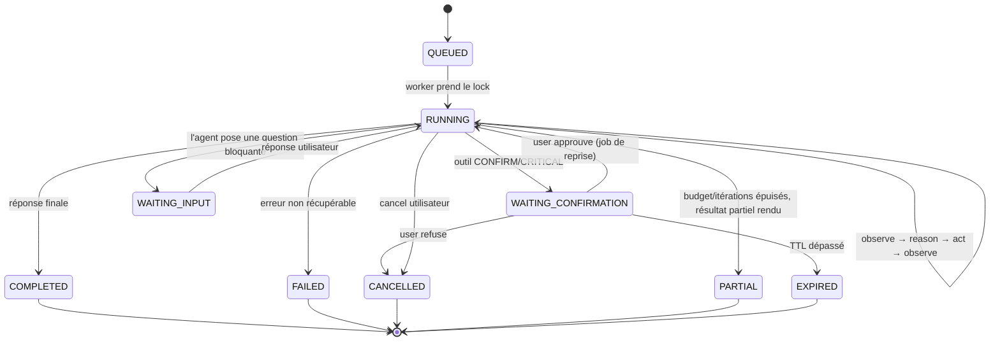

# 03 — Architecture de l'agent

## 1. Le principe : la boucle est un réducteur sur un état persisté

La formulation naïve d'une boucle agentique est une fonction récursive en mémoire. Elle ne
survit pas à trois exigences du cahier des charges : **confirmation humaine** (le run peut
attendre 10 minutes), **annulation** (depuis un autre appareil), **reprise après crash**.

Nous modélisons donc le run comme une machine à états dont chaque transition est persistée :

```
AgentRun  = { id, status, iteration, budget, cursor, ... }
AgentStep = { runId, index, type, input, output, tokens, cost, latency, error }
```

`step(state) → command` est une fonction **pure et testable** ; le worker exécute la commande,
persiste le nouvel état et rappelle `step`. Rejouer un run = rejouer ses steps. C'est la
propriété qui rend l'agent débuggable et évaluable (→ [ADR-003](../adr/ADR-003-durable-agent-loop.md)).

## 2. Machine à états



`PARTIAL` est un état de première classe, pas un échec : quand un budget s'épuise, l'agent
**doit** produire une synthèse de ce qu'il a appris et de ce qui reste à faire. Un agent qui
s'arrête sans rien dire est un bug produit.

## 3. La boucle

```
loop:
  0. guard        → budgets, timeout global, flag d'annulation, verrou
  1. observe      → assemble le contexte (Memory Assembler, §5)
  2. reason       → LLMProvider.stream(messages, tools autorisés)
                    tokens → événements WS au fil de l'eau
  3. decide       → réponse finale ? question ? appel(s) d'outil ?
  4. authorize    → validation zod des args + PermissionService.check()
                    DENY → observation d'erreur, retour en 1
                    CONFIRM → persiste Confirmation, suspend le run, LIBÈRE le worker
  5. execute      → ToolExecutor (timeout, retry, idempotence) ; parallèle si outils
                    indépendants et tous SAFE, séquentiel sinon
  6. observe      → normalise le résultat, tronque, réinjecte comme message tool
  7. reflect      → si N échecs consécutifs : force une étape de replanification
  8. compact      → si contexte > seuil : compaction (§5.4)
  9. continue     → iteration++ ; retour en 0
finish:
  réponse finale, persistance, extraction mémoire (async), run.completed
```

### Budgets et garde-fous

| Garde-fou                    | Défaut                        | Comportement au dépassement                     |
| ---------------------------- | ----------------------------- | ----------------------------------------------- |
| `maxIterations`              | 12                            | → `PARTIAL` avec synthèse                       |
| `maxWallClock`               | 180 s (600 s si tâche longue) | → `PARTIAL`                                     |
| `maxTokens` (run)            | 200 k                         | → compaction forcée puis `PARTIAL`              |
| `maxCostUsd` (run / jour)    | configurable                  | → `PARTIAL`, alerte                             |
| `maxToolCalls`               | 25                            | → `PARTIAL`                                     |
| `maxConsecutiveToolFailures` | 3                             | → replanification forcée, puis abandon expliqué |
| `maxSameToolSameArgs`        | 2                             | anti-boucle : refus + observation explicite     |

Les budgets sont **des données**, portées par `AgentRun.budget`, pas des constantes compilées :
une tâche « surveille ce déploiement » et une question météo n'ont pas le même profil.

### Annulation

`POST /agent/runs/:id/cancel` → écrit `cancelRequestedAt` en base **et** publie sur
`cancel:run:{id}`. Le worker écoute ce canal et détient un `AbortController` propagé jusqu'aux
appels HTTP des outils. L'annulation est vérifiée à chaque garde de boucle _et_ pendant le
streaming. Un outil déjà parti n'est pas magiquement annulé : on marque `ToolExecution.status =
ABORTED` et, si l'outil expose une annulation (Browser Worker, Device Agent), on la propage.

### Reprise sur erreur d'outil

Politique en cascade, décidée par `ToolFailurePolicy` et non par le modèle seul :

1. **Retry transparent** si `retryable` (429, 5xx, timeout réseau) — 3 tentatives, backoff
   exponentiel + jitter, jamais pour un outil non idempotent sans clé d'idempotence.
2. **Réinjection** de l'erreur normalisée au modèle (il peut corriger ses arguments).
3. **Outil de repli** si la définition en déclare un (`search.web` → `browser.act`).
4. **Abandon expliqué** : l'agent dit ce qui a échoué et pourquoi. Jamais de silence.

## 4. Planner

Deux modes, choisis par un routeur bon marché (heuristique + classification LLM courte) :

- **Mode réactif (défaut)** — pas de plan explicite ; la boucle ReAct suffit pour 80 % des
  demandes (« quelle météo », « ajoute un rdv »). Moins de latence, moins de tokens.
- **Mode planifié** — pour les demandes multi-étapes ou à effets de bord (« trouve un billet
  Paris–Alger vendredi soir »), le planner produit un `Plan` structuré
  (`structuredOutput()`), persisté en `Task`/`TaskStep`, affiché dans l'UI, et révisable :
  après chaque étape la boucle peut replanifier si l'observation invalide le plan.

Le plan est un **artefact utilisateur** autant qu'un artefact interne : c'est ce que le mobile
affiche pendant l'exécution, et ce qui rend l'agent lisible plutôt que magique.

## 5. Assemblage du contexte

Le `ContextAssembler` construit la fenêtre à chaque itération, avec un budget de tokens par
section — jamais « on empile jusqu'à ce que ça déborde » :

| Section                              | Budget indicatif | Source                                                 |
| ------------------------------------ | ---------------- | ------------------------------------------------------ |
| System prompt + identité + date/lieu | 5 %              | statique + `User`                                      |
| Préférences utilisateur              | 5 %              | `UserPreference` (structuré, jamais inféré à la volée) |
| Souvenirs pertinents                 | 15 %             | `Memory` via recherche hybride (§10)                   |
| Résumé de conversation               | 10 %             | `ConversationSummary`                                  |
| Fenêtre de messages récents          | 40 %             | `Message` (K derniers tours, intégraux)                |
| Résultats d'outils du run courant    | 20 %             | `AgentStep` (troncature intelligente)                  |
| Définitions d'outils                 | 5 %              | `ToolRegistry` filtré par permissions                  |

**Compaction** (§10.4) : quand la fenêtre dépasse le seuil, les tours les plus anciens sont
remplacés par un résumé produit par un modèle rapide, les résultats d'outils volumineux sont
remplacés par un extrait + une référence (`artifactId`) que l'agent peut re-consulter via un
outil `artifact.read`. On ne perd jamais l'information : on la déplace hors du contexte.

## 6. Ports de `@nexus/agent-core`

```ts
interface AgentDeps {
  llm: LLMProvider;
  tools: ToolRegistryView; // lecture seule, déjà filtrée par permissions
  executor: ToolExecutor;
  memory: MemoryPort;
  store: AgentRunStore; // persistance des steps
  events: EventPublisher; // → Redis → WS
  clock: Clock; // injecté : tests déterministes
  budget: BudgetGuard;
}
```

Aucune de ces dépendances n'est concrète dans le package. `agent-core` se teste intégralement
avec un `FakeLLM` scripté et des outils factices, sans Postgres, Redis, ni réseau
(→ [15-testing](15-testing.md)).
