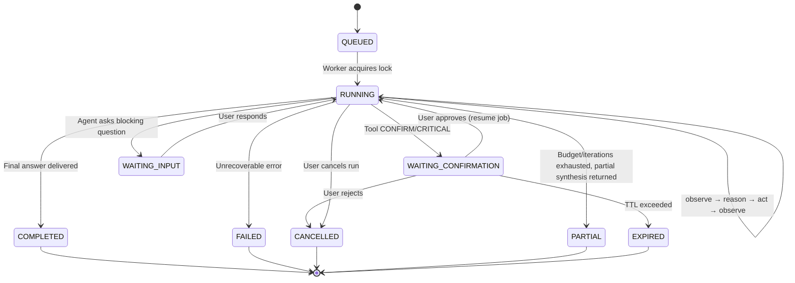

# 03 — Agent Architecture

## 1. Core Principle: The Loop is a Reducer Over Persisted State

The naive formulation of an agent loop is an in-memory recursive function. It fails when meeting three
critical production requirements: **human confirmation** (a run may pause for 10 minutes waiting for
approval), **cross-device cancellation**, and **resilience across crashes and restarts**.

We model each run as an explicit finite state machine where every transition is persisted:

```
AgentRun  = { id, status, iteration, budget, cursor, ... }
AgentStep = { runId, index, type, input, output, tokens, cost, latency, error }
```

`step(state) → command` is a **pure and testable** function; the worker processes the command,
persists the resulting state, and invokes `step` again. Replaying a run means replaying its steps.
This property makes the agent systematically debuggable and verifiable (→ [ADR-003](../adr/ADR-003-durable-agent-loop.md)).

## 2. State Machine



`PARTIAL` is a first-class state, not an unhandled failure: when an execution budget is exhausted, the
agent **must** synthesize what it learned and identify outstanding steps. An assistant that abruptly halts
in silence is a product defect.

## 3. The Execution Loop

```
loop:
  0. guard        → Budgets, global timeout, cancellation flag, distributed lock
  1. observe      → Assemble context (Context Assembler, §5)
  2. reason       → LLMProvider.stream(messages, authorized_tools)
                    Tokens stream to WebSocket subscribers in real time
  3. decide       → Final response? Blocking question? Tool invocation(s)?
  4. authorize    → Zod argument validation + PermissionService.check()
                    DENY → Error observation, return to step 1
                    CONFIRM → Persist Confirmation, suspend run, RELEASE worker
  5. execute      → ToolExecutor (timeout, retry, idempotency); parallelized if tools
                    are independent and SAFE, sequential otherwise
  6. observe      → Normalize result, truncate, re-inject as tool message
  7. reflect      → If N consecutive failures: trigger forced replanning step
  8. compact      → If context tokens > threshold: run compaction (§5)
  9. continue     → iteration++; return to step 0
finish:
  Final answer emitted, state persisted, asynchronous memory extraction, run.completed event
```

### Budgets and Safeguards

| Safeguard                    | Default                   | Behavior on Limit Exceeded                     |
| ---------------------------- | ------------------------- | ---------------------------------------------- |
| `maxIterations`              | 12                        | → `PARTIAL` with synthesis                     |
| `maxWallClock`               | 180s (600s for long jobs) | → `PARTIAL`                                    |
| `maxTokens` (run)            | 200k                      | → Forced compaction, then `PARTIAL`            |
| `maxCostUsd` (run / day)     | Configurable              | → `PARTIAL`, cost alert emitted                |
| `maxToolCalls`               | 25                        | → `PARTIAL`                                    |
| `maxConsecutiveToolFailures` | 3                         | → Forced replanning, then graceful abandonment |
| `maxSameToolSameArgs`        | 2                         | Anti-loop: rejection + explicit observation    |

Budgets are **data**, carried inside `AgentRun.budget`, not hardcoded constants: a deployment monitor
task and a weather lookup have fundamentally different profiles.

### Cancellation

`POST /agent/runs/:id/cancel` → Sets `cancelRequestedAt` in the database **and** publishes to
`cancel:run:{id}`. The worker subscribes to this channel and holds an `AbortController` passed down to
HTTP tool calls. Cancellation is verified at each loop guard _and_ during token streaming. An in-flight
action is handled cleanly: `ToolExecution.status = ABORTED` is recorded, and cancellation is forwarded
if the target worker supports it (Browser Worker, Device Agent).

### Recovery on Tool Failure

Tiered policy managed by `ToolFailurePolicy`, not left solely to model inference:

1. **Transparent Retry** if `retryable` (429, 5xx, network timeout) — 3 attempts, exponential backoff
   with jitter, never for non-idempotent operations lacking an idempotency key.
2. **Re-injection** of normalized error to the model (allowing it to fix arguments).
3. **Fallback Tool** if defined in the tool specification (e.g. `search.web` → `browser.act`).
4. **Explained Abandonment**: The agent clearly articulates what failed and why. Never silent failure.

## 4. Planner

Two modes, selected by a fast routing heuristic and lightweight LLM classification:

- **Reactive Mode (Default)** — No explicit plan DAG; standard ReAct execution suffices for 80% of
  requests ("what's the weather", "create a calendar reminder"). Lower latency and token usage.
- **Planned Mode** — For complex multi-step missions or mutating side effects ("find flight options
  for Friday evening"), the planner generates a structured `Plan` (`structuredOutput()`), persisted
  into `Task`/`TaskStep`, visualized in the UI, and revisable: after each step, the loop can replan if
  observations contradict assumptions.

The plan is a **user-facing artifact** as well as internal state: rendered in the dashboard and mobile
app during execution, making agent progress transparent and auditable.

## 5. Context Assembly

`ContextAssembler` builds the LLM prompt window on each iteration with strict token allocations per
section — avoiding unconstrained token expansion:

| Section                             | Target Budget | Source                                               |
| ----------------------------------- | ------------- | ---------------------------------------------------- |
| System prompt + identity + datetime | 5%            | Static template + `User` metadata                    |
| User preferences                    | 5%            | `UserPreference` (structured, never inferred on fly) |
| Relevant memory items               | 15%           | `Memory` retrieved via hybrid search (see §10)       |
| Conversation summary                | 10%           | `ConversationSummary`                                |
| Recent message history              | 40%           | `Message` (last K turns, uncompressed)               |
| Current run tool outputs            | 20%           | `AgentStep` (intelligent truncation)                 |
| Available tool definitions          | 5%            | `ToolRegistry` filtered by permissions               |

**Compaction**: When the context window reaches its threshold, older turns are replaced by a summary
generated by a fast model. Large tool outputs are replaced by an excerpt and an `artifactId` reference
that the agent can consult via an `artifact.read` tool. Information is never destroyed: it is moved
out of the immediate inference context into storage.

## 6. `@nexus/agent-core` Ports

```ts
interface AgentDeps {
  llm: LLMProvider;
  tools: ToolRegistryView; // Read-only, pre-filtered by user permissions
  executor: ToolExecutor;
  memory: MemoryPort;
  store: AgentRunStore; // Step persistence
  events: EventPublisher; // → Redis → WebSocket
  clock: Clock; // Injected for deterministic unit tests
  budget: BudgetGuard;
}
```

None of these dependencies are concrete inside the package. `agent-core` is tested exhaustively using a
scripted `FakeLLM` and mock tools without requiring PostgreSQL, Redis, or external network connectivity
(→ [15-testing](15-testing.md)).
