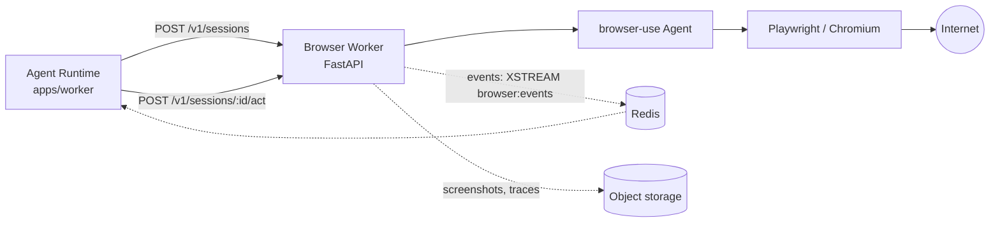

# 05 — Browser Use Worker

## 1. Why a Dedicated Service

`browser-use` is a Python library controlling Chromium instances via Playwright. Three reasons make
service isolation mandatory:

1. **Language Boundary** — The core backend is TypeScript. Architectural rules strictly forbid direct
   Python runtime imports. The integration is a clean network contract, not an in-process binding.
2. **Resource Management** — Chromium consumes 300 MB to 1 GB RAM and can crash under heavy DOM loads.
   It must never degrade the API or primary agent workers.
3. **Security Boundary** — The browser visits untrusted, potentially hostile web content by definition.
   It executes inside an isolated container with no internal network access, no backend secrets, and
   no host filesystem mounts.



## 1 bis. Connection to WorkerGateway

The Python service detailed below is not called directly by the agent loop. It is fronted by
`@nexus/browser-worker-host`, a **first-class NEXUS worker node** implementing the standard
`WorkerRuntime` interface shared by Windows and Android workers.

```
Agent → Plan → Required Capabilities → Authorization Gate
                                              │
                                        WorkerGateway
                                              │  Authenticated session (Ed25519)
                                 @nexus/browser-worker-host
                                              │  Versioned HTTP contract (§2)
                                   services/browser-worker (Python)
```

Advantages provided by the WorkerGateway architecture:

| Capability         | Guarantee                                                                     |
| ------------------ | ----------------------------------------------------------------------------- |
| Authentication     | Cryptographic challenge-response signing, not static tokens                   |
| Identity           | Dedicated device entry of type `BROWSER_WORKER`, instantly revocable          |
| Selection          | Dynamic `DeviceSelector` matching advertised browser capabilities             |
| Permissions        | Standard `browser.*` permission hierarchy                                     |
| Confirmations      | Tiered risk levels, escalating to `CRITICAL` for mutating transactions        |
| Health Monitoring  | Heartbeats; worker automatically delists if Chromium becomes unresponsive     |

Advertised capabilities comprise `browser.navigate`, `browser.interact`, `browser.login`, and
`browser.purchase`. Concrete operational limits remain enforced in `app/policies.py` on the Python
side: central core decides _what should be done_, the local worker enforces _what is permitted to happen_.

---

## 2. HTTP Contract

Versioned OpenAPI specification derived from `@nexus/contracts` schemas (JSON Schema export validated
against Pydantic models via cross-language contract tests).

| Method   | Route                     | Purpose                                                      |
| -------- | ------------------------- | ------------------------------------------------------------ |
| `POST`   | `/v1/sessions`            | Opens a browser session (profile, headless, proxy, TTL)      |
| `GET`    | `/v1/sessions/:id`        | Status, active URL, token cost, current screenshot           |
| `POST`   | `/v1/sessions/:id/act`    | Executes a natural language task or structured action        |
| `POST`   | `/v1/sessions/:id/cancel` | Cooperative task cancellation                                |
| `DELETE` | `/v1/sessions/:id`        | Terminates session, releases browser context                 |
| `GET`    | `/v1/health`              | Liveness and readiness checks (warm browser pool status)     |

Service-to-service authentication: mTLS **or** short-lived signed bearer tokens across private Docker
networks (the browser worker is never publicly exposed).

## 3. Two API Tiers for the Agent

The tool exposed to the model is not the raw HTTP endpoint. `BrowserToolSource` publishes:

- **`browser.act`** — High-level natural language prompt ("Find flight departures for tomorrow on this
  site"). The worker runs its internal `browser-use` visual agent loop. Flexible, token-intensive,
  non-deterministic. Enforces `CONFIRM` risk whenever actions mutate state (forms, logins, purchases).
- **`browser.navigate` / `.extract` / `.click` / `.type`** — Low-level, deterministic, fast. Preferred
  when DOM structure is known. `extract` operates as `SAFE`.

The agent planner selects between tiers, preferring deterministic operations where possible. This
duality avoids running a full neural browser loop simply to extract plaintext from a known article.

## 4. Real-Time Progress Streaming

The worker emits progress events to a Redis Stream `browser:events:{sessionId}`:

```json
{
  "t": "step",
  "i": 3,
  "action": "click",
  "target": "Search",
  "url": "https://example.com/search",
  "screenshotRef": "s3://nexus-artifacts/sessions/123/step-3.jpg",
  "ts": "2026-10-21T20:15:00Z"
}
```

The Agent Runtime relays these frames as `tool.progress` over the client WebSocket. The user watches
the browser navigate step-by-step through live screenshot previews. This provides transparency and
serves as the primary debugging interface for web tasks.

## 5. Security & Threat Mitigations

| Threat                                  | Mitigation                                                                                                                                                 |
| --------------------------------------- | ---------------------------------------------------------------------------------------------------------------------------------------------------------- |
| Indirect prompt injection from web DOM  | Page text marked as untrusted input; prohibited from privilege escalation or invoking `CRITICAL` tools (→ [09](09-security-permissions.md) §7)            |
| Credential exfiltration                 | Zero central secrets inside container; web session credentials injected via `secretRef` handles never revealed to LLM prompts                            |
| Internal network reconnaissance (SSRF)  | Isolated Docker network, strict egress filters, blocking RFC1918 subnets and cloud metadata endpoints (169.254.169.254)                                   |
| Chromium container escape               | Non-root container execution, strict `seccomp` profile, sandboxing enabled, automatic process recycling, hard session timeouts                             |
| Access to unauthorized domains          | User allowlist / denylist enforced at both backend executor and worker boundary                                                                           |
| Uncontrolled session costs              | Hard session limits (max steps, max wall-clock time, max LLM tokens) enforced autonomously by worker daemon                                              |

## 6. Lifecycle & Operational Resilience

- Pre-warmed pool of browser contexts avoiding ~2s cold-start overhead.
- Session TTL (default 10 minutes) + garbage collector reclaiming orphaned contexts.
- Optional persistent user profiles (saved site logins), encrypted at rest, isolated per tenant.
- Cooperative cancellation: the worker verifies cancellation flags between `browser-use` steps.
- Worker is **stateless regarding user domain data**: restarting the container discards ephemeral browser
  sessions (handled by the agent as a retryable `ToolExecutionError`), preserving database integrity.
