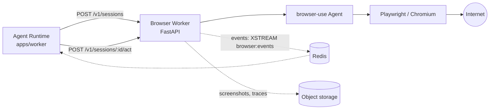

# 05 — Browser Use worker

## 1. Pourquoi un service séparé

`browser-use` est une bibliothèque Python qui pilote un navigateur Chromium via Playwright. Trois
raisons rendent l'isolation non négociable :

1. **Langage** — le backend est TypeScript. Le cahier des charges interdit l'import direct du code
   Python. La frontière est donc un contrat réseau, pas un binding.
2. **Ressources** — un Chromium consomme 300 Mo à 1 Go et peut planter. Il ne doit jamais pouvoir
   faire tomber l'API ou le worker agent.
3. **Sécurité** — le navigateur visite du contenu hostile par définition. Il tourne dans un
   conteneur sans accès au réseau interne, sans secrets applicatifs, sans volume monté.



## 1 bis. Raccordement au WorkerGateway (phase 9)

Le service Python décrit ci-dessous n'est pas joint directement par l'agent. Il
est précédé de `@nexus/browser-worker-host`, un **exécutant NEXUS à part
entière** — le même `WorkerRuntime` que le worker Windows et le worker Android.

```
Agent → plan → capacités requises → autorisation
                                          │
                                   WorkerGateway
                                          │  session authentifiée (Ed25519)
                            @nexus/browser-worker-host
                                          │  contrat HTTP versionné (§2)
                              services/browser-worker (Python)
```

Ce que ce raccordement apporte, et qu'un appel HTTP direct ne donnait pas :

|                  |                                                                            |
| ---------------- | -------------------------------------------------------------------------- |
| Authentification | signature d'un défi, pas un jeton statique                                 |
| Identité         | un appareil de type `BROWSER_WORKER`, révocable                            |
| Sélection        | `DeviceSelector`, sur capacités annoncées                                  |
| Permissions      | `browser.*`, comme toute capacité d'appareil                               |
| Confirmations    | par niveau de risque, jusqu'à `CRITICAL` pour un achat                     |
| Santé            | battements ; l'exécutant disparaît du sélecteur si Chromium ne répond plus |

Les capacités annoncées sont `browser.navigate`, `browser.interact`,
`browser.login` et `browser.purchase` — une par intention. La restriction réelle
des actions reste dans `app/policies.py`, côté Python : le cœur décide _ce qu'on
veut faire_, le worker décide _ce qu'il est possible de faire_.

---

## 2. Contrat HTTP

Versionné, décrit en OpenAPI, généré depuis les mêmes schémas que `@nexus/contracts`
(JSON Schema exporté → modèles Pydantic vérifiés par un test de contrat).

| Verbe    | Route                     | Rôle                                                          |
| -------- | ------------------------- | ------------------------------------------------------------- |
| `POST`   | `/v1/sessions`            | Ouvre une session navigateur (profil, headless, proxy, TTL)   |
| `GET`    | `/v1/sessions/:id`        | État, URL courante, coût, screenshot courant                  |
| `POST`   | `/v1/sessions/:id/act`    | Exécute une tâche en langage naturel ou une action structurée |
| `POST`   | `/v1/sessions/:id/cancel` | Annulation coopérative                                        |
| `DELETE` | `/v1/sessions/:id`        | Ferme la session, libère le contexte                          |
| `GET`    | `/v1/health`              | Liveness + readiness (pool de navigateurs)                    |

Authentification service-à-service : mTLS **ou** token porteur signé à courte durée + réseau
Docker privé (le worker n'est jamais exposé publiquement).

## 3. Deux niveaux d'API pour l'agent

L'outil exposé au LLM n'est pas l'API brute. `BrowserToolSource` publie :

- **`browser.act`** — haut niveau, prompt en langage naturel (« sur ce site, récupère les
  horaires »). Le worker exécute sa propre boucle `browser-use`. Puissant, coûteux, non
  déterministe. Risque `CONFIRM` dès que la tâche peut muter un état (formulaire, achat, login).
- **`browser.navigate` / `.extract` / `.click` / `.type`** — bas niveau, déterministe, bon marché.
  Préféré quand la page est connue. `extract` est `SAFE`.

L'agent choisit ; le planner est instruit de préférer le bas niveau quand c'est possible. Cette
dualité est ce qui évite de payer un sous-agent LLM complet pour lire une page.

## 4. Streaming de progression

Le worker publie sur un Redis Stream `browser:events:{sessionId}` :

```json
{
  "t": "step",
  "i": 3,
  "action": "click",
  "target": "Rechercher",
  "url": "https://...",
  "screenshotRef": "s3://.../3.jpg",
  "ts": "..."
}
```

L'Agent Runtime relaie en `tool.progress` sur le WebSocket client. L'utilisateur **voit** ce que
le navigateur fait, capture après capture. C'est à la fois une fonctionnalité produit et le
principal outil de débogage de cette brique.

## 5. Sécurité

| Menace                                  | Mitigation                                                                                                                                                                 |
| --------------------------------------- | -------------------------------------------------------------------------------------------------------------------------------------------------------------------------- |
| Injection de prompt depuis une page web | Le contenu de page est balisé comme donnée non fiable ; il ne peut jamais élever un privilège ni déclencher un outil `CRITICAL` (→ [09](09-security-permissions.md) §7)    |
| Exfiltration de secrets                 | Aucun secret applicatif dans le conteneur ; les credentials de site vivent dans le coffre et sont injectés par un mécanisme `secretRef` que le LLM ne voit jamais en clair |
| Accès au réseau interne                 | Réseau Docker isolé, egress filtré, blocage RFC1918 + metadata cloud (169.254.169.254)                                                                                     |
| Escape / crash Chromium                 | Conteneur non-root, `seccomp`, pas de `--no-sandbox`, redémarrage automatique, TTL de session                                                                              |
| Domaines interdits                      | Allowlist/denylist par utilisateur, vérifiée côté worker _et_ côté outil                                                                                                   |
| Coût qui dérive                         | Budget par session (steps max, durée max, tokens max) appliqué par le worker                                                                                               |

## 6. Cycle de vie & robustesse

- Pool de N contextes navigateur préchauffés (démarrage à froid ≈ 2 s évité).
- TTL de session (défaut 10 min) + garbage collector ; une session orpheline est fermée.
- Profils persistants **optionnels** par utilisateur (cookies de connexion), chiffrés au repos,
  jamais partagés entre utilisateurs.
- `cancel` coopératif : le flag est vérifié entre deux steps `browser-use`.
- Le worker est **stateless côté métier** : perdre le conteneur perd les sessions en cours (que
  l'agent traite comme une `ToolExecutionError` retryable), jamais des données.
