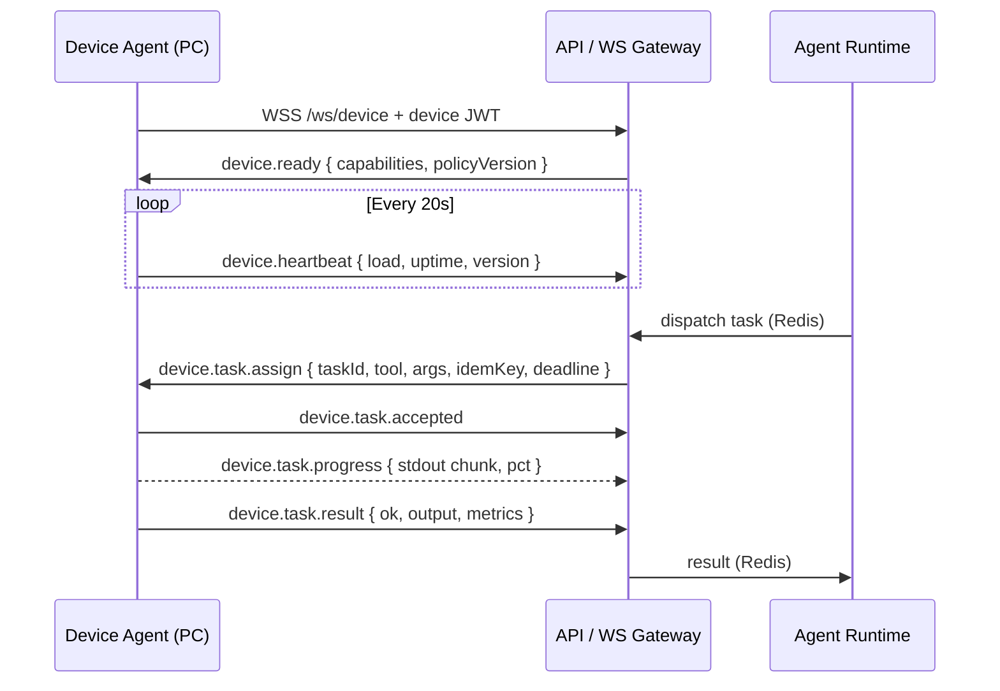

# 06 — Devices & Device Agent

## 1. The Concept

A **Device** is an enrolled machine capable of executing tasks on behalf of its owner: reading and
writing files, executing shell commands, inspecting Docker containers, or opening code projects.
The **Device Agent** is the daemon running on that machine.

Critical flow inversion: The central server **never** initiates inbound connections to the PC.
Instead, the PC establishes an outbound WebSocket connection to the server. No firewall ports to open,
no NAT traversal hurdles, no static IP requirements. The server then pushes tasks through this channel.



## 2. Technical Choice: Headless Node + Tauri Shell

The Device Agent is a **headless Node.js daemon** decoupled from the desktop GUI application
(→ [ADR-007](../adr/ADR-007-device-agent-node.md)):

- It shares `@nexus/device-protocol` and `@nexus/contracts` directly — a single typed protocol, never
  reimplemented in Rust;
- It runs **without a display server**, as a background Windows Service, launchd daemon, or systemd unit:
  the agent can execute tasks even when the desktop GUI is closed;
- The Tauri desktop app installs it, monitors its status, exposes it in the UI (status, live logs,
  permissions), and can launch it as a local sidecar for lightweight setups.

Distribution: Single-file binary via Node Single Executable Applications (SEA) or `pkg`, signed, with
cryptographically verified auto-updates.

## 3. Enrollment and Authentication

**Pairing** (once per machine):

1. The user navigates to Settings → Devices → "Add Device"; the API generates a single-use 8-character
   `pairingCode` with a 5-minute TTL.
2. The Device Agent submits this code alongside a freshly generated **Ed25519 public key**; the private
   key is retained in the OS secure credential store (DPAPI on Windows, Keychain on macOS, Secret Service on Linux).
3. The server registers the `Device` and returns a `deviceId` plus an enrollment certificate.

**Connection** (on each session): Challenge-response handshake. The server transmits a cryptographic
nonce, and the agent signs it using its private key. No long-lived shared secrets traverse the wire; a
token leaked in application logs is insufficient to impersonate the machine. A `Device` can be revoked
immediately via the UI (revocation abruptly terminates the active socket connection, not merely future ones).

## 4. Local Security Policy

The worker enforces **its own local policy**, completely independent of central server instructions.
This defense-in-depth guarantee ensures that even if the backend is compromised, client workstations do
not become unrestricted targets.

### Evolution from Environment Variables

Basic policies previously existed — allowed root paths, allowed binaries, passed environment variables,
Docker subcommands, Git write permissions — but lived inside **environment variables**, causing three issues:

1. **Poor Readability.** `WORKER_ALLOWED_PATHS=C:\a,C:\b` is hard to audit before placing trust in it.
2. **No Exclusions.** One could only allow roots. Restricting access to `~/.ssh` _beneath_ an allowed
   workspace was impossible — precisely the critical scenario: allowing a project folder while excluding
   sensitive subtrees.
3. **Silent Mistakes.** A typo in a comma-separated list would silently expand or restrict file boundaries.

### The Policy Configuration File

`~/.nexus/device-policy.yaml`, parsed upon worker startup. When present, it **overrides** corresponding
environment settings: there must never be conflicting sources of truth regarding machine boundaries,
and ambiguity around precedence is an attack surface. When absent, default configurations apply seamlessly.

```yaml
version: 1
filesystem:
  allow: [~/projects] # Nothing is accessible outside these directories
  deny: # Denials always take precedence, even within allowed trees
    under: [~/.ssh, ~/.aws, ~/.gnupg]
    segments: [node_modules, .git]
    names: [.env*, id_rsa, credentials*]
  maxFileSizeMb: 20
exec:
  mode: allowlist # or `disabled`
  allowedExecutables: [git, node, pnpm, python]
  allowedEnv: [PATH, HOME, LANG]
  timeoutSec: 300
git: { allowWrite: false }
docker: { allowedSubcommands: [ps, images, logs, inspect] }
network: { egress: deny }
```

### Key Design Decisions

**No Shell Command String Whitelisting.** The original design draft proposed `shell: { allow: ["git *", "pnpm *"] }`.
This is intentionally not implemented: the worker **never** accepts arbitrary command strings. Its API
is structured — an executable binary name and an array of arguments, completely bypassing shell interpolation —
which _eliminates_ shell injection vulnerabilities rather than attempting to filter them. String matching
would introduce a weaker model under the guise of hardening.

**No Complex Glob Matchers.** Denials are expressed via three narrow, deterministic rules: under a
directory path, by path segment, or by exact filename with at most one trailing asterisk. For denial lists,
the parser's complexity is itself an attack surface: wildcard engines behave inconsistently across
escaping rules, casing conventions, and symlinks. The essential protection requirements are handled
deterministically without globs.

**No "Interactive Prompt" Mode.** A confirmation gate is a human decision that belongs on an
interactive client surface — not on a headless machine without a display. The worker evaluates
_locally_ whether an action is permitted; it does not pause for prompts. Setting `exec.mode: disabled`
omits execution capabilities from being advertised to the central server, informing the planner upfront
that the device cannot run shell tasks rather than continually failing individual assignments.

### Invariant Safeguards

The policy can only **restrict further**. Hardcoded worker denials — `~/.ssh`, `.gnupg`, `id_rsa`,
SAM hives, Windows Credential Manager paths — remain active regardless of custom YAML configuration,
even if someone accidentally allows `C:\`. This enables fearless local policy customization.

Denials evaluate **case-insensitively**, while allowances respect filesystem casing. This intentional
asymmetry ensures that an overly broad denial yields a readable error message, whereas a missed denial
risks credential leakage.

### Policy CLI Utilities

```sh
nexus policy init                                  # Writes an annotated template, refuses to overwrite
nexus policy show                                  # Displays active policy and source
nexus policy check --path ~/.ssh/id_ed25519        # Evaluates verdict and explanation
nexus policy check --exec curl
```

`check` is essential: a security policy that cannot be verified interactively is prone to misunderstanding.
It returns exit code `2` on denial and `0` on approval — a denial is a valid query result rather than an
execution failure, making it scriptable in CI.

These commands never overwrite existing policies without `--force`. "Editor" does not mean "writable
by NEXUS": this file is where the host defends itself **from the central agent**, and a policy that the
agent could modify would provide zero defense.

An **invalid syntax file** halts the worker startup immediately and is never silently replaced by defaults.

### Implementation Status

- **File size limits**: Read, validated, and displayed; the low-level `filesystem.read` handler is
  being wired to enforce this streaming bound.
- **`network.egress`**: Currently declarative; outbound calls are not made by default.
- **Android Worker**: Uses native mobile sandboxing rather than this YAML configuration, maintaining
  Hermes runtime portability.

## 5. Reliability and Fault Tolerance

| Aspect           | Mechanism                                                                                   |
| ---------------- | ------------------------------------------------------------------------------------------- |
| Heartbeat        | Every 20s; updates `lastSeenAt` in database; marked offline after 60s                       |
| Reconnection     | Exponential backoff with jitter, capped at 30s, indefinite retry loop                       |
| Task Resumption  | Upon reconnecting, the agent reports the status of active in-flight tasks (`taskId`)        |
| Idempotency      | Unique `idemKey` per task; previously executed tasks return cached results (1h TTL)         |
| Cancellation     | `device.task.cancel` → SIGTERM followed by SIGKILL after grace period; tree-kill for childs |
| Local Queue      | Bounded concurrent tasks; excess tasks rejected explicitly rather than queueing infinitely  |
| Audit Logs       | Local rotating audit file + structured server telemetry; fully inspectable by user          |
| Offline Handling | If no device is online, `device.*` tools vanish from registry and planner explains why      |

## 6. Explicit Non-Goals for Device Agent

- It never invokes LLM inference. It contains no autonomous decision logic, only platform capabilities.
- It has zero direct access to central PostgreSQL databases or application-level secrets.
- It does not define high-level permission policy: it **enforces** constraints locally as a second line
  of defense behind server authorization gates.
