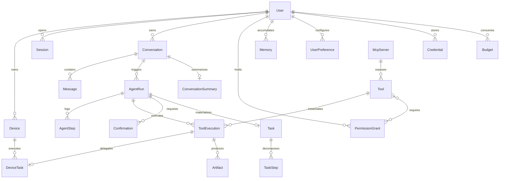

# 07 — Data Model

PostgreSQL 16 + `pgvector` extension. Prisma manages schema definitions, migrations, and TypeScript
type generation. All primary keys are **UUID v7** (time-sortable, B-tree friendly, cryptographically
unguessable). All timestamps use `timestamptz` stored in UTC.

## 1. Entity Overview



## 2. Identity and Access

**User** — `id, email, displayName, locale, timezone, status, createdAt, updatedAt`
Zero plaintext passwords; Argon2id password hash isolated inside `AuthCredential` (separated so that
queries for `User` records never accidentally load cryptographic password hashes).

**Session** — Authentication session, **distinct** from conversational context.
`id, userId, deviceId?, refreshTokenHash, userAgent, ip, expiresAt, revokedAt, lastUsedAt`
Rotating refresh tokens on every issuance; replay of an already consumed refresh token indicates theft
and immediately revokes the entire associated session family.

**Device** — `id, userId, name, platform, publicKey, agentVersion, status(ONLINE|OFFLINE|REVOKED),
capabilities Json, policyHash, lastSeenAt, pairedAt, revokedAt`
`capabilities` are advertised by the device agent (`fs`, `shell`, `docker`, `git`, etc.) and constrain
what tasks the server may dispatch to it.

**Credential** — Vault for third-party user credentials (Google/GitHub OAuth tokens, API keys, session cookies).
`id, userId, provider, scopes, ciphertext, iv, authTag, keyVersion, expiresAt, rotatedAt`
AES-256-GCM envelope encryption; never exposed across API responses; never exposed to LLM prompts
(→ [09-security](09-security-permissions.md) §5).

## 3. Conversations and Messages

**Conversation** — `id, userId, title, status, pinnedAt, lastMessageAt, tokenCount, archivedAt`

**Message** — `id, conversationId, role(USER|ASSISTANT|SYSTEM|TOOL), content Jsonb,
contentText (generated full-text search column), toolCallId?, runId?, tokensIn, tokensOut,
model?, createdAt, editedAt, status`
`content` is an array of typed blocks (`text`, `tool_call`, `tool_result`, `image`, `audio`) rather
than a raw string, enabling rich UI rendering and accurate context reconstruction across different LLMs.

**ConversationSummary** — `id, conversationId, uptoMessageId, summary, tokens, model, createdAt`
Cumulative compaction summaries; summary history is retained for debugging and regression audits.

## 4. Agent Execution State

**AgentRun** — `id, conversationId, userId, triggerMessageId, status, mode(REACTIVE|PLANNED),
iteration, maxIterations, budget Jsonb, usage Jsonb, model, startedAt, endedAt,
cancelRequestedAt, error Jsonb, resumeCursor Jsonb`
`resumeCursor` allows runs to resume cleanly following human confirmations or unexpected worker restarts.

**AgentStep** — `id, runId, index, type(OBSERVE|REASON|PLAN|TOOL_CALL|TOOL_RESULT|CONFIRM|
COMPACT|FINALIZE), input Jsonb, output Jsonb, tokensIn, tokensOut, costUsd, latencyMs,
error Jsonb, createdAt`
`UNIQUE(runId, index)` constraint: guarantees logical exactly-once step transitions upon resume.

**Task / TaskStep** — User-facing plan materialization.
`Task: id, userId, runId?, title, description, status, priority, scheduledFor?, recurrence?,
progress, resultSummary, createdAt`
`TaskStep: id, taskId, index, title, status, toolExecutionId?, output`
`Task` also represents scheduled or recurring autonomous missions ("Every morning, summarize industry news").

## 5. Tools and Executions

**Tool** — Persisted tool catalog (enables UI permission inspection and audit logging even for dynamic MCP tools).
`id, name, version, source(BUILTIN|MCP|BROWSER|DEVICE|HTTP), mcpServerId?, title, description,
inputSchema Jsonb, outputSchema Jsonb, riskLevel, requiresConfirmation, idempotent, sideEffects,
timeoutMs, enabled, discoveredAt, deprecatedAt`

**ToolExecution** — `id, runId?, stepId?, userId, toolId, toolName, toolVersion,
input Jsonb (redacted), output Jsonb (redacted), summaryForModel, status(PENDING|RUNNING|SUCCESS|
FAILED|DENIED|TIMEOUT|ABORTED), riskLevel, confirmationId?, deviceTaskId?, idempotencyKey,
attempt, startedAt, endedAt, durationMs, costUsd, error Jsonb`
`UNIQUE(idempotencyKey)`. Serves as the primary immutable audit trail for real-world side effects:
long retention window, never pruned by context compaction.

**Artifact** — Large outputs stored outside the immediate LLM context window.
`id, toolExecutionId?, userId, kind(FILE|IMAGE|SCREENSHOT|JSON|TEXT|AUDIO), storageKey, mimeType,
sizeBytes, sha256, preview, expiresAt`

**McpServer** — `id, userId?, slug, transport(STDIO|HTTP), command?, args, envRefs, url?,
status, defaultRiskLevel, enabled, lastHandshakeAt, lastError`

**DeviceTask** — `id, deviceId, toolExecutionId, tool, args Jsonb, status, idempotencyKey,
assignedAt, acceptedAt, finishedAt, exitCode?, stdoutRef?, stderrRef?, error Jsonb`

## 6. Permissions and Confirmation Gates

**PermissionGrant** — Long-lived authorization grants.
`id, userId, subject(TOOL|TOOL_PATTERN|CAPABILITY), subjectKey ('mail.send', 'device.fs.*'),
scope Jsonb (constraints: allowed domains, path sandboxes, budget thresholds, recipient lists),
decision(ALLOW|ALWAYS_CONFIRM|DENY), grantedAt, expiresAt?, deviceId?, revokedAt, source(USER|DEFAULT)`
Deny by default: missing grants evaluate to denial. `scope` allows policies such as "permit `device.fs.write`
strictly under `~/workspace`".

**Confirmation** — Single-use interactive approval request.
`id, userId, runId, toolExecutionId?, riskLevel, title, summary, diff Jsonb?, payloadHash,
status(PENDING|APPROVED|REJECTED|EXPIRED), rememberChoice bool, expiresAt, decidedAt,
decidedFromDeviceId, nonce`
`payloadHash` binds approval to the exact evaluated arguments: modifying a single character post-approval
invalidates the confirmation, preventing bait-and-switch attacks.

**AuditLog** — `id, userId, actor(USER|AGENT|SYSTEM|DEVICE), action, subjectType, subjectId,
riskLevel, ip, deviceId, metadata Jsonb, createdAt` — Append-only, immutable, retained for at least 1 year.

## 7. Long-Term Memory and Preferences

**Memory** — `id, userId, type(SEMANTIC|EPISODIC|PROCEDURAL), content, embedding vector(1536),
sourceMessageId?, sourceRunId?, confidence, importance, accessCount, lastAccessedAt, validFrom,
validUntil?, supersededById?, tags text[], createdAt`
Facts are superseded rather than overwritten: "User lives in Seattle" remains historically valid until
a change of residence is recorded, enabling temporal queries ("Where did I live last year?").

**UserPreference** — `id, userId, key, value Jsonb, source(EXPLICIT|INFERRED), confidence,
updatedAt` — `UNIQUE(userId, key)`. Inferred preferences are suggested to the user, never silently applied.

## 8. Infrastructure State

**OutboxEvent** — `id, aggregateType, aggregateId, type, payload, status, attempts, availableAt, publishedAt`
**IdempotencyKey** — `key, userId, endpoint, requestHash, responseStatus, responseBody, expiresAt`
**Budget** — `id, userId, period, tokensUsed, costUsd, runsCount, toolCalls Jsonb, resetAt`
**Notification** — `id, userId, type, payload, deliveredAt, readAt` (push notifications for pending
confirmations when clients are backgrounded).

## 9. Critical Indexes

```sql
Message              (conversationId, createdAt DESC)
Message              GIN(to_tsvector('english', contentText))
AgentRun             (userId, status, startedAt DESC) ; (status) WHERE status IN ('QUEUED','RUNNING')
AgentStep            UNIQUE(runId, index)
ToolExecution        (userId, startedAt DESC) ; (toolName, status) ; UNIQUE(idempotencyKey)
Confirmation         (userId, status) WHERE status = 'PENDING'
Memory               HNSW(embedding vector_cosine_ops) ; (userId, type, importance DESC)
Memory               GIN(to_tsvector('english', content))   -- Hybrid retrieval index
Device               (userId, status) ; (lastSeenAt)
OutboxEvent          (status, availableAt) WHERE status = 'PENDING'
```

## 10. Data Retention Policies

| Data Entity               | Retention Window                     | Operational Reason                                |
| ------------------------- | ------------------------------------ | ------------------------------------------------- |
| `Message`, `Conversation` | Indefinite (user archives)           | Primary product value                             |
| `AgentStep`               | 90 days detailed, then aggregated    | Trace storage volume; step debugging is near-term |
| `ToolExecution`           | 1 year minimum                       | Verifiable audit trail of real-world actions      |
| `AuditLog`                | 1 year minimum, append-only          | Security compliance                               |
| `Artifact`                | 30 days default, pinnable by user    | Object storage optimization                       |
| `Memory`                  | Indefinite, editable by user         | Core personalized memory                          |
| Raw Audio Recordings      | Ephemeral, immediate zero-retention  | Privacy-first architecture, transcripts retained  |

Account deletion: Cascading removal across tables + object storage purge within 30 days, retaining
an anonymized deletion certificate for regulatory compliance.
