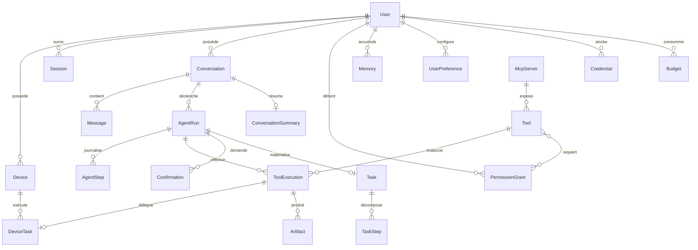

# 07 — Modèle de données

PostgreSQL 16 + extension `pgvector`. Prisma pour le schéma, les migrations et le typage.
Toutes les clefs primaires sont des **UUID v7** (triables par le temps, index-friendly, non
devinables). Tous les timestamps sont `timestamptz` en UTC.

## 1. Vue d'ensemble



## 2. Identité & accès

**User** — `id, email, displayName, locale, timezone, status, createdAt, updatedAt`
Aucun mot de passe en clair ; hash Argon2id dans `AuthCredential` (séparée, pour pouvoir la lire
sans jamais charger le hash par accident).

**Session** — session d'authentification, **distincte** d'une conversation.
`id, userId, deviceId?, refreshTokenHash, userAgent, ip, expiresAt, revokedAt, lastUsedAt`
Rotation du refresh token à chaque usage ; réutilisation d'un token déjà consommé = vol présumé →
révocation de toute la famille de sessions.

**Device** — `id, userId, name, platform, publicKey, agentVersion, status(ONLINE|OFFLINE|REVOKED),
capabilities Json, policyHash, lastSeenAt, pairedAt, revokedAt`
`capabilities` est déclaré par l'agent (`fs`, `shell`, `docker`, `git`…) et borne ce que le
serveur peut lui demander.

**Credential** — coffre des identifiants tiers (OAuth Google/GitHub, clefs API, cookies de site).
`id, userId, provider, scopes, ciphertext, iv, authTag, keyVersion, expiresAt, rotatedAt`
Chiffrement enveloppe AES-256-GCM ; jamais exposé par l'API ; jamais visible du LLM
(→ [09-security](09-security-permissions.md) §5).

## 3. Conversation

**Conversation** — `id, userId, title, status, pinnedAt, lastMessageAt, tokenCount, archivedAt`

**Message** — `id, conversationId, role(USER|ASSISTANT|SYSTEM|TOOL), content Jsonb,
contentText (généré, pour la recherche plein texte), toolCallId?, runId?, tokensIn, tokensOut,
model?, createdAt, editedAt, status`
`content` est un tableau de blocs typés (`text`, `tool_call`, `tool_result`, `image`, `audio`) et
non une chaîne : c'est ce qui permet de rendre l'UI riche et de recomposer le contexte fidèlement
pour n'importe quel provider LLM.

**ConversationSummary** — `id, conversationId, uptoMessageId, summary, tokens, model, createdAt`
Résumés cumulatifs pour la compaction ; on garde l'historique des résumés (débogage, régression).

## 4. Agent

**AgentRun** — `id, conversationId, userId, triggerMessageId, status, mode(REACTIVE|PLANNED),
iteration, maxIterations, budget Jsonb, usage Jsonb, model, startedAt, endedAt,
cancelRequestedAt, error Jsonb, resumeCursor Jsonb`
`resumeCursor` est ce qui rend le run reprenable après une confirmation ou un crash.

**AgentStep** — `id, runId, index, type(OBSERVE|REASON|PLAN|TOOL_CALL|TOOL_RESULT|CONFIRM|
COMPACT|FINALIZE), input Jsonb, output Jsonb, tokensIn, tokensOut, costUsd, latencyMs,
error Jsonb, createdAt`
Contrainte `UNIQUE(runId, index)` : elle garantit l'exactly-once logique lors d'une reprise.

**Task / TaskStep** — matérialisation utilisateur d'un plan.
`Task: id, userId, runId?, title, description, status, priority, scheduledFor?, recurrence?,
progress, resultSummary, createdAt`
`TaskStep: id, taskId, index, title, status, toolExecutionId?, output`
`Task` sert aussi aux tâches **planifiées** ou récurrentes (« chaque matin, résume mes mails »).

## 5. Outils

**Tool** — catalogue persisté (nécessaire pour l'UI, les permissions et l'audit, même quand la
définition vient de MCP).
`id, name, version, source(BUILTIN|MCP|BROWSER|DEVICE|HTTP), mcpServerId?, title, description,
inputSchema Jsonb, outputSchema Jsonb, riskLevel, requiresConfirmation, idempotent, sideEffects,
timeoutMs, enabled, discoveredAt, deprecatedAt`

**ToolExecution** — `id, runId?, stepId?, userId, toolId, toolName, toolVersion,
input Jsonb (rédigé), output Jsonb (rédigé), summaryForModel, status(PENDING|RUNNING|SUCCESS|
FAILED|DENIED|TIMEOUT|ABORTED), riskLevel, confirmationId?, deviceTaskId?, idempotencyKey,
attempt, startedAt, endedAt, durationMs, costUsd, error Jsonb`
`UNIQUE(idempotencyKey)`. C'est **le** journal d'audit des actions réelles : rétention longue,
jamais supprimé par la compaction.

**Artifact** — sorties volumineuses hors contexte.
`id, toolExecutionId?, userId, kind(FILE|IMAGE|SCREENSHOT|JSON|TEXT|AUDIO), storageKey, mimeType,
sizeBytes, sha256, preview, expiresAt`

**McpServer** — `id, userId?, slug, transport(STDIO|HTTP), command?, args, envRefs, url?,
status, defaultRiskLevel, enabled, lastHandshakeAt, lastError`

**DeviceTask** — `id, deviceId, toolExecutionId, tool, args Jsonb, status, idempotencyKey,
assignedAt, acceptedAt, finishedAt, exitCode?, stdoutRef?, stderrRef?, error Jsonb`

## 6. Permissions & confirmations

**PermissionGrant** — l'autorisation durable.
`id, userId, subject(TOOL|TOOL_PATTERN|CAPABILITY), subjectKey ('mail.send', 'device.fs.*'),
scope Jsonb (contraintes : domaines, chemins, montant max, destinataires),
decision(ALLOW|ALWAYS_CONFIRM|DENY), grantedAt, expiresAt?, deviceId?, revokedAt, source(USER|DEFAULT)`
Deny par défaut : l'absence de grant vaut refus. `scope` permet « autorise `device.fs.write`
mais seulement sous `~/dev` ».

**Confirmation** — la demande ponctuelle.
`id, userId, runId, toolExecutionId?, riskLevel, title, summary, diff Jsonb?, payloadHash,
status(PENDING|APPROVED|REJECTED|EXPIRED), rememberChoice bool, expiresAt, decidedAt,
decidedFromDeviceId, nonce`
`payloadHash` lie la décision aux arguments exacts : si l'agent modifie ne serait-ce qu'un
caractère après l'approbation, l'exécution est refusée. C'est la garantie anti-« bait and switch ».

**AuditLog** — `id, userId, actor(USER|AGENT|SYSTEM|DEVICE), action, subjectType, subjectId,
riskLevel, ip, deviceId, metadata Jsonb, createdAt` — append-only, jamais modifié, jamais purgé
avant 1 an.

## 7. Mémoire & préférences

**Memory** — `id, userId, type(SEMANTIC|EPISODIC|PROCEDURAL), content, embedding vector(1536),
sourceMessageId?, sourceRunId?, confidence, importance, accessCount, lastAccessedAt, validFrom,
validUntil?, supersededById?, tags text[], createdAt`
Les faits ne sont pas supprimés mais **supersédés** : « il habite à Paris » reste vrai jusqu'au
2026-03-01, puis est remplacé. On peut donc répondre à « où j'habitais l'an dernier ».

**UserPreference** — `id, userId, key, value Jsonb, source(EXPLICIT|INFERRED), confidence,
updatedAt` — `UNIQUE(userId, key)`. Une préférence inférée est **proposée**, pas appliquée
silencieusement.

## 8. Infrastructure

**OutboxEvent** — `id, aggregateType, aggregateId, type, payload, status, attempts, availableAt,
publishedAt`
**IdempotencyKey** — `key, userId, endpoint, requestHash, responseStatus, responseBody, expiresAt`
**Budget** — `id, userId, period, tokensUsed, costUsd, runsCount, toolCalls Jsonb, resetAt`
**Notification** — `id, userId, type, payload, deliveredAt, readAt` (push mobile pour les
confirmations quand l'app est fermée).

## 9. Index critiques

```
Message              (conversationId, createdAt DESC)
Message              GIN(to_tsvector('french', contentText))
AgentRun             (userId, status, startedAt DESC) ; (status) WHERE status IN ('QUEUED','RUNNING')
AgentStep            UNIQUE(runId, index)
ToolExecution        (userId, startedAt DESC) ; (toolName, status) ; UNIQUE(idempotencyKey)
Confirmation         (userId, status) WHERE status = 'PENDING'
Memory               HNSW(embedding vector_cosine_ops) ; (userId, type, importance DESC)
Memory               GIN(to_tsvector('french', content))   -- recherche hybride
Device               (userId, status) ; (lastSeenAt)
OutboxEvent          (status, availableAt) WHERE status = 'PENDING'
```

## 10. Rétention

| Donnée                    | Durée                                 | Motif                                      |
| ------------------------- | ------------------------------------- | ------------------------------------------ |
| `Message`, `Conversation` | illimitée (archivage utilisateur)     | valeur produit                             |
| `AgentStep`               | 90 j détaillé, puis agrégé            | volume ; le débogage passé 90 j est rare   |
| `ToolExecution`           | 1 an minimum                          | audit des actions réelles                  |
| `AuditLog`                | 1 an minimum, append-only             | sécurité                                   |
| `Artifact`                | 30 j par défaut, épinglable           | stockage                                   |
| `Memory`                  | illimitée, révision par l'utilisateur | c'est le produit                           |
| Audio brut (voix)         | 7 j puis suppression                  | données sensibles, transcription conservée |

Suppression de compte : effacement en cascade + purge du stockage objet sous 30 jours, avec
journal de suppression conservé (RGPD).
