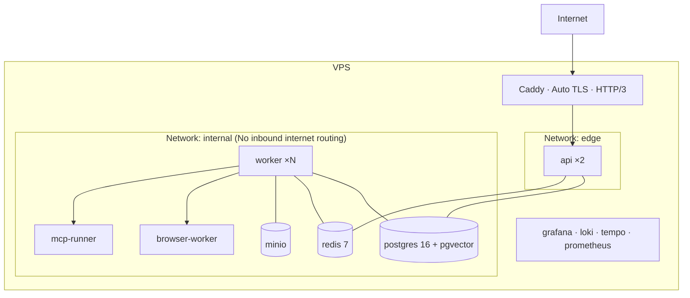

# 14 — Deployment Architecture

## 1. Target Environment

A single VPS (4 vCPU / 8–16 GB RAM / 100 GB SSD, ~$25–50/month) running Docker Compose.
Kubernetes is intentionally omitted: for single-tenant private usage, an orchestrator would consume
more administrative time than the service itself (→ [ADR-015](../adr/ADR-015-deployment-compose.md)).
The codebase remains "K8s-ready": stateless containers, 12-factor configuration, health probes,
and decoupled schema migrations.

## 2. Topology



Only Caddy exposes public ports (443, 80). `browser-worker` and `mcp-runner` have **zero published host ports**
and live within an internal network without ingress routing; egress traffic is strictly filtered.

## 3. Services

| Service          | Container Image                     | Operational Notes                                                                |
| ---------------- | ----------------------------------- | -------------------------------------------------------------------------------- |
| `caddy`          | caddy:2                             | Automated Let's Encrypt TLS, reverse proxy, WebSocket upgrades, compression      |
| `api`            | node:22-alpine (distroless in prod) | 2 replicas, `/healthz` probe, non-root user                                      |
| `worker`         | node:22-alpine                      | BullMQ concurrency tuning, graceful drain termination                            |
| `browser-worker` | python:3.12 + Playwright            | `shm_size: 1g`, memory limits, seccomp filters, non-root                         |
| `mcp-runner`     | node:22-alpine                      | Hosts stdio MCP servers, minimal environment variables, isolated network        |
| `postgres`       | pgvector/pgvector:pg16              | Persistent volume, scheduled `pg_dump`, continuous WAL archiving                 |
| `redis`          | redis:7-alpine                      | AOF `everysec`; job queues and streaming state are fully reconstructible         |
| `minio`          | minio                               | Artifacts, audio buffers, screenshots; interchangeable with S3/R2                |
| `migrate`        | node:22-alpine                      | One-shot schema migration job before app boot (`depends_on: service_completed`)  |
| `backup`         | alpine + cron                       | Automated encrypted backups pushed to offsite object storage                     |

Hardened defaults: `restart: unless-stopped`, explicit healthchecks, CPU/memory quotas, structured
JSON logging with log-rotation, non-root execution, and read-only container root filesystems where possible.

## 4. Configuration Management

Three distinct tiers, strictly separated:

1. **Build Time** — Container image versions, compiler flags.
2. **Deployment Time** — Machine `.env` on VPS (Docker secrets for sensitive keys), outside Git tracking,
   backed up separately.
3. **Runtime Configuration** — Dynamic settings modified without redeployment (active providers,
   budgets, MCP servers, security policies) persisted in PostgreSQL, editable via dashboard.

`@nexus/config` validates all environment variables at startup using Zod. A missing or invalid key
**aborts startup immediately** — a fast fail during deployment is far safer than discovering a missing
credential mid-execution.

## 5. Continuous Deployment Pipeline

```
git push main
 → CI: Install (frozen lockfile) → Typecheck → Lint → Test → Build → Integration tests (ephemeral DB)
 → Security Scan: gitleaks, pnpm audit, Trivy container vulnerability scanner
 → Build & Push: Container images tagged by commit SHA
 → Deploy: SSH into VPS → Pull images → Run DB migration job → Rolling restart API → Worker drain restart
 → Automated smoke tests → Automated rollback to previous release tag upon failure
```

**Database Migrations**: Additive-first evolution (expand/contract pattern). A column is never removed
until one deployment after application code has ceased referencing it. The migration container runs
in isolation before application containers start.

**Graceful Termination**: On `SIGTERM`, the API stops accepting new connections, drains active WebSockets
(broadcasting a `server.shutdown` notice inviting clients to reconnect), and terminates. Workers allow
active steps to finish or re-enqueue tasks into BullMQ without state loss.

## 6. Backup & Disaster Recovery

| Data Component            | Frequency           | Retention Window         | Backup Destination            |
| ------------------------- | ------------------- | ------------------------ | ----------------------------- |
| PostgreSQL (Encrypted DB) | Every 6 hours       | 30 days + 1 monthly/year | Offsite S3 / Cloudflare R2    |
| Continuous WAL Archives   | Streaming           | 7 days                   | Offsite S3 (PITR recovery)    |
| MinIO Artifact Storage    | Daily               | 30 days                  | Offsite S3                    |
| Deployment `.env` Secrets | On every change     | Indefinite               | Secure offline password vault |

Restoration drills are **tested monthly** using `infra/scripts/restore-drill.sh`, bootstrapping a clean
instance from encrypted backups. An untested backup is not a valid backup.

## 7. Environments

- **Local**: Lightweight Compose (PostgreSQL, Redis, MinIO) + `pnpm dev` with hot-reloading;
  providers mockable via deterministic fakes (zero API keys required to boot and develop).
- **Staging** (Optional): Matching Compose configuration on an isolated subdomain with synthetic data.
- **Production**: Hardened VPS host.

## 8. Horizontal Scaling Path

When scaling beyond a single VPS is required, the architecture scales naturally:
Managed PostgreSQL → Managed Redis → `browser-worker` and `mcp-runner` placed on dedicated compute nodes →
autoscaled BullMQ workers → Kubernetes cluster. Zero application rewrites are needed because services
are stateless and communicate strictly via versioned network contracts.
