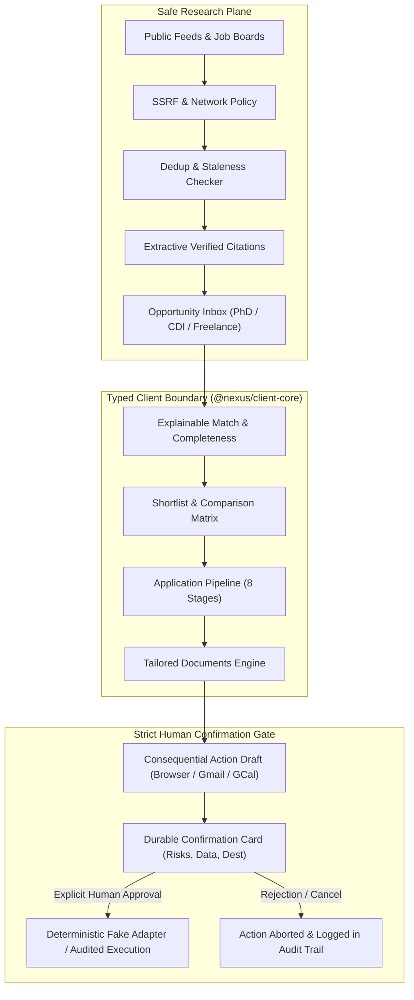

# NEXUS Career & Education Architecture & Dashboard Specification

## 1. Executive Summary & Strategic Vision

The **NEXUS Career & Education capability** delivers an open-source, user-centric orchestration system for comprehensive career and academic trajectory planning. Unlike legacy job scrapers or auto-apply bots that spam recruiters and jeopardize applicant reputation, NEXUS operates under strict principles of:

1. **Multi-Track Discovery**: Unified, side-by-side discovery and comparison of:
   - **Doctoral & Academic Research (PhD)**: Doctoral school contracts, CIFRE / ANR / ERC funded fellowships, prospective academic advisors, and laboratory groups.
   - **Permanent Industry Employment (CDI)**: Staff and principal engineering positions, salary brackets, equity components, and jurisdiction protections.
   - **Freelance & Consulting Missions**: Daily rates (TJM), weekly allocation (e.g. 4 days/week), mission duration, and commercial terms.
2. **Safe Research Plane**: Authorized public feeds only, strict SSRF prevention, cryptographic citation hashes, staleness scoring, and automated duplicate resolution.
3. **Explainable Match Intelligence**: Algorithmic scoring decomposed into skills overlap, rate expectations, location flexibility, and track suitability, with explicit strengths and gaps.
4. **Tailored Application Preparation**: Role-specific adaptation of CVs, cover letters, research statements, and commercial rate cards with inspectable diff summaries.
5. **Durable Human Confirmation Boundary**: **Zero silent mutations**. Consequential external interactions (form submissions via browser automation, email dispatches via Gmail, calendar scheduling via Google Calendar) stop at durable, explicit confirmation cards detailing exact destinations, attached data, explicit risks, and real-world consequences.



---

## 2. Ownership Boundaries & Client Contracts

### 2.1 Team Ownership

- **Antigravity Team Ownership**:
  - Dashboard UX and responsive presentation components (`apps/dashboard/src/ui/CareerEducation/*`).
  - Safe research plane abstractions, citation verification, and SSRF validation policies.
  - Strict typed client boundary (`CareerEducationClient` in `@nexus/client-core`).
  - Deterministic contract-backed fake adapter (`FakeCareerEducationClient`).
  - Accessibility (WCAG 2.1 AA), keyboard navigation, focus management, and responsive layouts.
- **Claude Team Ownership**:
  - Dedicated backend persistence services and database migrations (`services/api`, `packages/database`).
  - Production MCP tool adapters and backend mission engine domain entities.

### 2.2 Typed Client Boundary (`@nexus/client-core/src/career-education`)

The contract boundary is strictly typed to guarantee zero reliance on unvalidated wire types or runtime mocks:

```typescript
export interface CareerEducationClient {
  // Profile & Completeness
  getProfile(): Promise<CareerEducationProfile>;
  updateProfile(profile: Partial<CareerEducationProfile>): Promise<CareerEducationProfile>;

  // Settings & Quiet Hours
  getSettings(): Promise<CareerEducationSettings>;
  updateSettings(settings: Partial<CareerEducationSettings>): Promise<CareerEducationSettings>;

  // Discovery & Multi-Track Filtering
  searchOpportunities(query: OpportunitySearchQuery): Promise<OpportunitySearchResult>;
  getOpportunity(id: string): Promise<Opportunity>;
  toggleShortlist(id: string, shortlisted: boolean): Promise<Opportunity>;
  compareOpportunities(ids: string[]): Promise<OpportunityComparisonMatrix>;

  // Saved Searches & Monitored Feeds
  getSavedSearches(): Promise<SavedSearch[]>;
  createSavedSearch(input: CreateSavedSearchInput): Promise<SavedSearch>;
  deleteSavedSearch(id: string): Promise<void>;
  getMonitoredSources(): Promise<MonitoredSource[]>;
  refreshSource(id: string): Promise<MonitoredSource>;

  // Applications Kanban & Timeline
  getApplications(): Promise<Application[]>;
  updateApplicationStage(id: string, stage: ApplicationStage, note?: string): Promise<Application>;
  createApplication(opportunityId: string): Promise<Application>;

  // Tailored Documents & Diffs
  getDocuments(applicationId?: string): Promise<DocumentVariant[]>;
  generateDocumentVariant(input: GenerateDocumentInput): Promise<DocumentVariant>;

  // Deadlines & Calendar
  getDeadlines(): Promise<Deadline[]>;
  createDeadline(input: CreateDeadlineInput): Promise<Deadline>;
  toggleDeadlineCompleted(id: string, completed: boolean): Promise<Deadline>;

  // Contacts, Outcomes & Analytics
  getAnalytics(): Promise<CareerAnalytics>;
  getContacts(opportunityId?: string): Promise<Contact[]>;
  getInterviews(applicationId?: string): Promise<Interview[]>;
  recordOutcome(input: RecordOutcomeInput): Promise<Outcome>;

  // Human Confirmation Center
  getConfirmations(status?: ConfirmationStatus): Promise<ConfirmationRequest[]>;
  requestConfirmation(input: CreateConfirmationInput): Promise<ConfirmationRequest>;
  resolveConfirmation(
    id: string,
    decision: "approve" | "reject" | "cancel",
    reason?: string,
  ): Promise<ConfirmationRequest>;

  // Audit Log
  getAuditEvents(limit?: number): Promise<AuditEvent[]>;

  // Safe Research Operations
  executeSafeSearch(query: string, track?: OpportunityTrack | "all"): Promise<SafeSearchResponse>;
  prepareDraftApplication(
    opportunityId: string,
    formValues: Record<string, string>,
  ): Promise<ConfirmationRequest>;
  prepareDraftEmail(
    opportunityId: string,
    to: string,
    subject: string,
    body: string,
  ): Promise<ConfirmationRequest>;
  prepareDraftCalendarEvent(
    opportunityId: string,
    title: string,
    start: string,
    end: string,
  ): Promise<ConfirmationRequest>;
}
```

---

## 3. Safe Research Plane & Deterministic Adapters

### 3.1 SSRF & Network Policy

The safe research plane enforces hermetic network boundaries:

1. **Target Validation**: All URLs undergo DNS resolution and IP verification prior to connection.
2. **Blocked Destinies**: Private IP ranges (RFC 1918, RFC 3927, loopback `127.0.0.0/8`, IPv6 local `::1`, link-local `fe80::/10`) and cloud metadata endpoints (`169.254.169.254`, `metadata.google.internal`) are strictly rejected.
3. **No Embedded Credentials**: URLs containing basic authentication credentials (`user:pass@host`) trigger immediate rejection.
4. **Standard Web Ports**: Restricts traffic strictly to HTTP (80) and HTTPS (443).

### 3.2 Extractive Public Citations

Opportunities retain evidence traces to guarantee that no position or funding condition is hallucinated:

- Every claim (e.g. stipend level, contract type, required publications) references a verified quote from public listing content.
- Cryptographic SHA-256 fingerprinting binds quotes to document bodies.
- Unverified claims are prominently flagged in the UI.

### 3.3 Duplicate Detection & Staleness

- **Duplicate Markers**: Detects syndicated postings across aggregator boards using canonical URL headers and SHA-256 content hashing. Duplicates display warning banners linking directly to original listings.
- **Freshness Classification**:
  - `fresh`: Published within 30 days, actively accepting submissions.
  - `aging`: Published between 31 and 90 days.
  - `stale`: Published > 90 days or deadline past; filtered by default to avoid wasted applicant preparation.

---

## 4. Multi-Track Comparison & Strategic Tradeoffs

The side-by-side comparison matrix evaluates positions across structural metrics:

| Metric                 | PhD Fellowship                                                      | CDI Permanent Job                                                | Freelance Mission                                             |
| ---------------------- | ------------------------------------------------------------------- | ---------------------------------------------------------------- | ------------------------------------------------------------- |
| **Contract**           | 3-Year Doctoral Contract                                            | Indefinite Term (CDI)                                            | Fixed Duration Service Tender (3-12 mos)                      |
| **Compensation**       | €2,200 - €2,800/mo gross (CIFRE/ANR)                                | €90,000 - €135,000/yr gross + Equity                             | €650 - €950/day HT (TJM)                                      |
| **Intellectual Focus** | Fundamental research, peer-reviewed publications, academic autonomy | Scalability, production reliability, core infrastructure roadmap | Targeted architecture interventions, latency reduction, audit |
| **Flexibility**        | Onsite lab / conference travel                                      | Hybrid / European remote                                         | 100% Remote (typical 4 days/week)                             |
| **Risk / Durability**  | Guaranteed funding for 36 months                                    | Statutory European labor protections                             | Contract renewals required periodically                       |

---

## 5. Application Preparation & Tailored Documents

For every shortlisted position, the tailoring engine analyzes profile credentials against job criteria:

- **CV Variants**: Emphasizes relevant competencies (e.g., formal verification with TLA+ for LIP6 PhD, or high-throughput consensus for CloudScale CDI).
- **Motivation Letters**: Tailors opening thesis statements and technical justifications based on company or lab open-source contributions.
- **Research Statements**: Outlines 3-year doctoral methodology, state-of-the-art context, and proposed invariant synthesis.
- **Rate Cards**: Formalizes commercial terms, daily rates, days/week availability, and delivery milestones.
- **Diff Summaries**: Highlights sections tailored, skills emphasized, and customized clauses.

---

## 6. Durable Human Confirmation Architecture

Consequential actions MUST NEVER execute silently. The confirmation boundary enforces:

1. **Stop at Preview / Draft**:
   - Web application form: Browser worker fills form inputs and halts at submit button.
   - Outreach communication: Google Workspace prepares Gmail draft and halts before `gmail.send`.
   - Interview scheduling: Calendar integration constructs appointment slot and halts before `calendar.create_event`.
2. **Transparent Confirmation Cards**:
   - **Exact Action**: Clear label and action type icon.
   - **Destination**: Absolute URL, email address, or calendar destination.
   - **Transmitted Data & Attached Documents**: Form fields, email body preview, and document SHA-256 hashes.
   - **Explicit Risks**: e.g., _"External portal submission is irreversible once transmitted"_, _"Applicant personal data transferred"_.
   - **Consequences**: e.g., _"Locks candidacy in for 2026 CIFRE cohort"_, _"Initiates official university review"_.
3. **Discrete Decision Lifecycle**:
   - `approve`: Human operator explicitly authorizes action with optional rationale.
   - `reject`: Human operator rejects action; external transmission is completely blocked.
   - `cancel`: Operator discards draft.
   - `expired`: Unapproved actions expire safely when their TTL elapses.

---

## 7. Accessibility (a11y) & UX Integrity

- **Semantic HTML & ARIA**:
  - Full tab list navigation with `role="tablist"`, `role="tab"`, and `role="tabpanel"`.
  - Accessible dialogs and drawers with `role="dialog"`, `aria-modal="true"`, and escape key dismiss.
  - Alert banners with `role="alert"` and live status regions with `aria-live="polite"`.
- **Keyboard Navigation**:
  - Tab and Shift+Tab traversal across all interactive controls.
  - Visible focus rings (`:focus-visible`) matching NEXUS palette.
- **Honest States (Zero Silent Success)**:
  - Offline network simulation displays explicit offline banner with connection retry.
  - Degraded monitored feeds display HTTP 429 rate limit backoff alerts.

---

## 8. Claude Backend Handoff Specification

When Claude's team implements the backend domain services, they should adhere to the following wire contracts and guarantees:

### 8.1 Required Endpoints

| Endpoint                                     | Method     | Expected Payload / Response                                                                              |
| -------------------------------------------- | ---------- | -------------------------------------------------------------------------------------------------------- |
| `/api/v1/career/profile`                     | GET / PUT  | `CareerEducationProfile` with automatic completeness scoring                                             |
| `/api/v1/career/settings`                    | GET / PUT  | `CareerEducationSettings`                                                                                |
| `/api/v1/career/opportunities`               | GET        | Query params: `track`, `minScore`, `onlyFresh`, `includeDuplicates` -> returns `OpportunitySearchResult` |
| `/api/v1/career/opportunities/:id/shortlist` | POST       | `{ shortlisted: boolean }` -> returns updated `Opportunity`                                              |
| `/api/v1/career/opportunities/compare`       | POST       | `{ ids: string[] }` -> returns `OpportunityComparisonMatrix`                                             |
| `/api/v1/career/applications`                | GET / POST | `Application` lifecycle operations                                                                       |
| `/api/v1/career/applications/:id/stage`      | PUT        | `{ stage: ApplicationStage, note?: string }`                                                             |
| `/api/v1/career/documents/tailor`            | POST       | `GenerateDocumentInput` -> returns `DocumentVariant`                                                     |
| `/api/v1/career/confirmations`               | GET / POST | Confirmation request queries                                                                             |
| `/api/v1/career/confirmations/:id/resolve`   | POST       | `{ decision: "approve" \| "reject" \| "cancel", reason?: string }`                                       |

### 8.2 Invariants Expected from Backend

1. **Deterministic Confirmation Guarantees**: Under no circumstances may an external mutation trigger without a matching `AuditEvent` containing `decision: "approved"` signed by an authorized human operator session.
2. **SSRF Guardrails**: The backend must enforce independent network policy assertions duplicating client-side checks before performing any external fetch.
3. **Data Retention Compliance**: The backend scheduler must periodically sweep and purge documents, application drafts, and audit events older than configured `retentionDays`.
