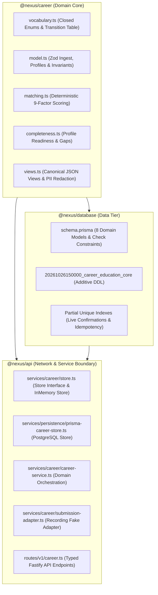
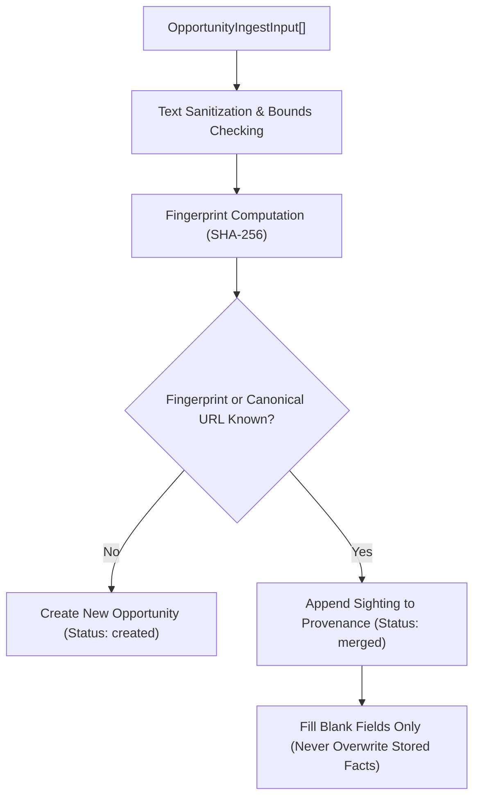
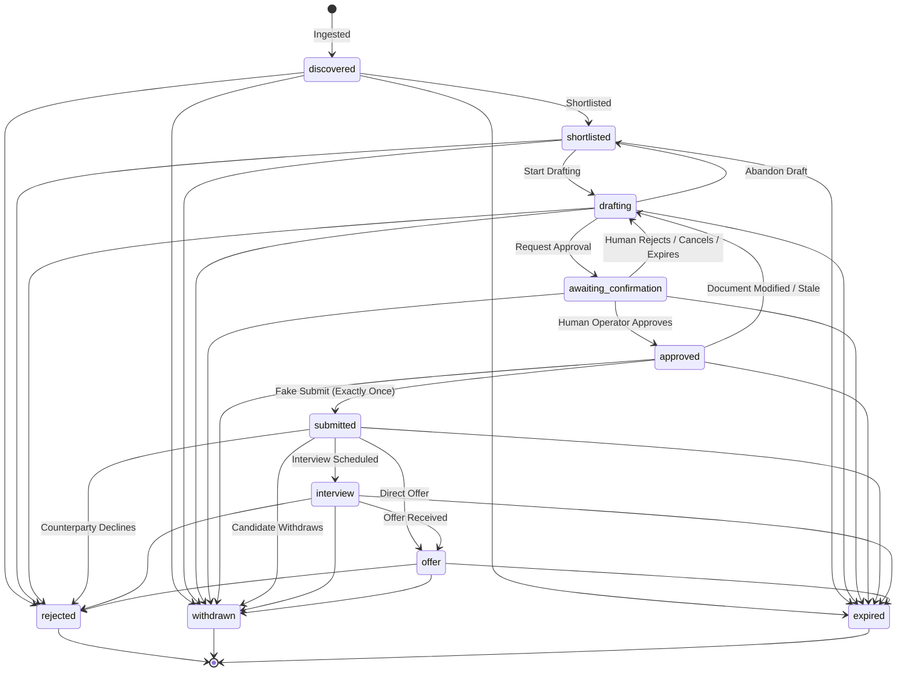
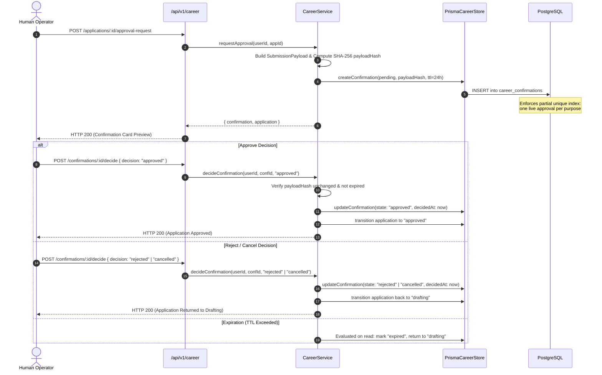
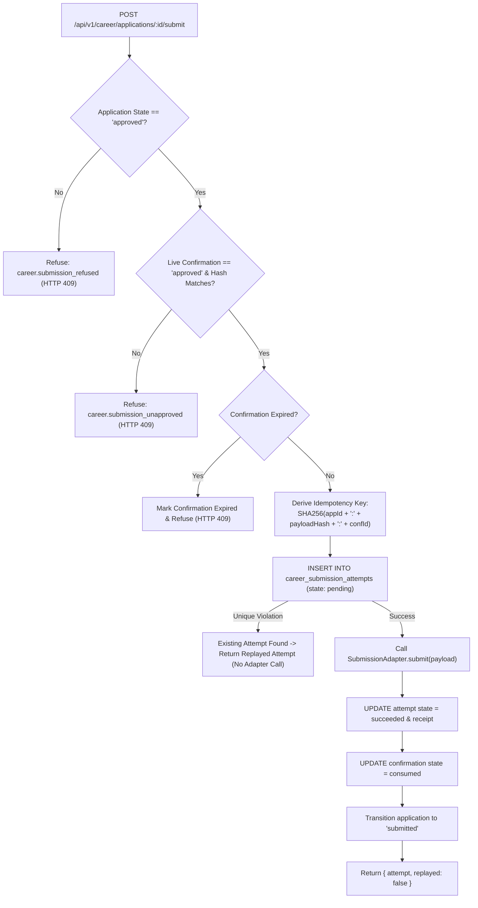

# NEXUS Career & Education Architecture Specification

## 1. Executive Summary & Vision

The **NEXUS Career & Education** subsystem is the backend foundation for user-controlled, multi-track career trajectory planning and verified application orchestration. It is designed to empower candidates across three primary tracks:

1. **Doctoral & Academic Research (PhD)**: Fellowships (CIFRE, ANR, ERC, Doctoral Schools), laboratory matching, supervisor research areas, and publication alignment.
2. **Permanent Industry Employment (CDI)**: Senior and staff engineering roles, verified compensation brackets, equity structures, and notice period constraints.
3. **Independent Consulting & Freelance**: Target daily rates (TJM), weekly allocation, mission duration, and commercial terms.

Operating under the NEXUS core principle that **the core is the authority and humans remain in control**, this subsystem guarantees:

- **Zero silent mutations or autonomous submissions**: Consequential external transmissions require durable, cryptographic human approval.
- **Explainable algorithmic matching**: Transparent, multi-factor scoring with concrete textual evidence rather than black-box models.
- **Strict tenant isolation**: Structural database-level owner isolation with 404 absence guarantees against enumeration.
- **Restart-safe, exactly-once submission**: Atomic database idempotency locks ensuring no application is ever submitted twice, even across server crashes.
- **Safe research plane**: Verified provenance tracking, deduplication by fingerprint and canonical URL, and complete PII/secret redaction.
- **Deterministic fake adapter default**: No real external side-effects (no emails sent, no accounts created, no calendar entries modified, no paid APIs called).

---

## 2. Monorepo Architecture & Package Boundaries

The Career & Education capability spans three core workspace layers:



### 2.1 `@nexus/career`

The pure domain package containing zero runtime dependencies (only Zod). It defines:

- **Closed vocabulary**: Strict enums for `OpportunityKind` (`phd`, `permanent_job`, `freelance`), `ApplicationState`, `ConfirmationState`, `DocumentVariantKind`, `DeadlineKind`, `OutcomeResult`, and `SubmissionAttemptState`.
- **Lifecycle state machine**: Exhaustive `TRANSITIONS` matrix prohibiting invalid progression.
- **Explainable matching engine**: Deterministic arithmetic scoring factoring skills, track preference, location, compensation, languages, deadlines, and provenance confidence.
- **Completeness analyzer**: Scoring and readiness blocking per track.
- **Serialization views**: Centralized mapping ensuring document bodies are not leaked on list endpoints and email addresses are masked outside authenticated single-resource reads.

### 2.2 `@nexus/database`

PostgreSQL persistence driven by Prisma and verified additive migrations:

- **Tables**: `career_profiles`, `career_opportunities`, `career_applications`, `career_document_variants`, `career_contacts`, `career_deadlines`, `career_interviews`, `career_outcomes`, `career_follow_ups`, `career_confirmations`, `career_submission_attempts`, and `career_application_events`.
- **Check constraints**: Enforces hex hash formatting, valid score ranges (0–100), and consistency between confirmation state, decision timestamps, and consumption.
- **Partial unique indexes**:
  - `career_confirmations_one_live_per_purpose`: Guarantees at most one live (`pending` or `approved`) confirmation per application and purpose.
  - `career_submission_attempts_userId_idempotencyKey_key`: Guarantees exactly-once submission execution.

### 2.3 `@nexus/api`

Wires the storage and domain engine into the Fastify server:

- `PrismaCareerStore`: Implements the `CareerStore` contract with strict owner scoping (`where: { userId }`).
- `CareerService`: Enforces application gates, durable confirmation lifecycle, and audit events.
- `careerRoutes`: REST endpoints registered under `/api/v1/career/*`, validated by `fastify-type-provider-zod`.

---

## 3. Owner Isolation & Security Architecture

### 3.1 Structural Isolation

Every table in the career schema carries a `userId` foreign key referencing `users(id)` with `ON DELETE CASCADE`. When an account is removed, all career artifacts are automatically and cleanly purged.

### 3.2 Query-Level Tenant Isolation

There is no un-scoped `getApplication(id)` method. The owner identifier is the first mandatory parameter of every store method:

```typescript
getApplication(userId: string, id: string): Promise<Application | undefined>;
getOpportunity(userId: string, id: string): Promise<Opportunity | undefined>;
```

If a record belongs to another user, queries return `undefined` (or HTTP 404), never HTTP 403. This eliminates resource existence enumeration attacks.

### 3.3 PII & Secret Redaction

- **Contact Emails**: Returned in full only on authenticated direct contact endpoints for the authorized user. On audit events, submission logs, and notifications, emails are masked using `maskEmail(email)` (e.g. `a***@example.org`).
- **Audit Sanitization**: Context objects appended to `ApplicationEvent` are passed through `redactForAudit()`. Fields named `email`, `body`, `draft`, `token`, `password`, `secret`, `authorization`, etc. are stripped, nested objects are redacted up to 4 levels, and strings are bounded to 200 characters.

---

## 4. Safe Research Plane & Ingest Deduplication

Incoming job listings and funding opportunities are ingested through `/api/v1/career/ingest`.



### 4.1 Fingerprinting

Every opportunity is identified by a deterministic SHA-256 fingerprint derived from normalized title, organization, and location:

```
fingerprint = sha256(normalize(title) + "|" + normalize(organization) + "|" + normalize(location))
```

### 4.2 Provenance & Non-Destructive Sighting

Multiple sightings from different sources (official portals, aggregator feeds, referral messages) do not spawn duplicate listings. Instead, the sighting is appended to the opportunity's `provenance` array.

- **Filling blanks**: New sightings only populate fields that were previously empty (`location`, `description`, `compensation`, `closesAt`). Stored facts read from official sources are never overwritten by aggregators.
- **Confidence scoring**:
  - `official_site`: 1.0
  - `institutional_registry`: 0.98
  - `referral`: 0.95
  - `manual_entry`: 0.90
  - `aggregator`: 0.85
  - `unverified`: 0.60

---

## 5. Explainable Matching & Ranking Engine

The matching engine ranks opportunities against the candidate's profile preferences using 9 deterministic arithmetic factors:

| Factor                 | Weight | Evaluation Criteria                                                                     |
| ---------------------- | ------ | --------------------------------------------------------------------------------------- |
| `kind`                 | 20     | Exact match against candidate's preferred tracks (`phd`, `permanent_job`, `freelance`). |
| `must_have_skills`     | 25     | Overlap with candidate's declared mandatory skills.                                     |
| `profile_skills`       | 15     | Overlap with candidate's broader skill inventory.                                       |
| `location`             | 15     | Location name match or remote policy compatibility.                                     |
| `languages`            | 10     | Match between candidate's language proficiencies and listing requirements.              |
| `compensation`         | 10     | Salary/stipend/TJM meets or exceeds `minCompensation`.                                  |
| `deadline_feasibility` | 5      | Remaining time until deadline exceeds candidate's `noticePeriodDays`.                   |
| `research_area`        | 15     | For PhD track: alignment with declared doctoral topics.                                 |
| `freshness`            | 5      | Days elapsed since `postedAt`.                                                          |

The weighted score (0–100) is multiplied by the highest provenance confidence score. Hard exclusions (excluded organizations or unsupported tracks) immediately mark the opportunity `excluded: true` with an explicit human-readable `exclusionReason`.

---

## 6. Application Pipeline Lifecycle

The application lifecycle follows a strict state transition table:



### Invariants:

1. `approved` is reachable **only** from `awaiting_confirmation` via human approval.
2. `submitted` is reachable **only** from `approved` via the submission execution flow.
3. `rejected`, `withdrawn`, and `expired` are **terminal** states with zero outbound transitions.

---

## 7. Durable Human Confirmation Boundary

Consequential external actions (form submissions, draft exports) halt at durable confirmation cards:



### Discrete Confirmation Decisions:

- `approved`: Confirms that the exact payload, documents, and destination are authorized. Application moves to `approved`.
- `rejected`: Explicit human rejection. Application safely returns to `drafting` with an audit trail note.
- `cancelled`: Human operator discards or cancels the pending draft. Application safely returns to `drafting`.
- `expired`: Unanswered confirmations pass their TTL (default 24 hours), transition to `expired`, and forbid submission.

---

## 8. Restart-Safe Exactly-Once Submission Engine

Submission is protected by three independent safety locks:



### Crash Recovery & Replay Safety:

- The derived idempotency key `submissionIdempotencyKey({ applicationId, payloadHash, confirmationId })` is bound to the attempt row.
- If the server crashes immediately after calling the adapter or inserting the attempt, a subsequent call reproduces the exact key and hits the PostgreSQL unique constraint (`career_submission_attempts_userId_idempotencyKey_key`).
- The replayed attempt is returned without touching the adapter again.
- The `RecordingSubmissionAdapter` records all invocations in memory and produces verifiable SHA-256 receipts, ensuring zero real-world side effects.

---

## 9. Dashboard API Wire Contracts

The API conforms to the contracts expected by the completed `antigravity/career-education-ux` frontend:

| Endpoint                                           | Method | Request Payload                                                          | Response Data                                                                         | Description                                                  |
| -------------------------------------------------- | ------ | ------------------------------------------------------------------------ | ------------------------------------------------------------------------------------- | ------------------------------------------------------------ |
| `/api/v1/career/profile`                           | GET    | None                                                                     | `{ profile: CareerProfile, completeness: CompletenessReport }`                        | Fetches candidate profile and readiness scores.              |
| `/api/v1/career/profile`                           | PUT    | `CareerProfileInput`                                                     | `{ profile: CareerProfile, completeness: CompletenessReport }`                        | Updates profile and recalculates completeness.               |
| `/api/v1/career/settings`                          | GET    | None                                                                     | `CareerEducationSettings`                                                             | Returns dashboard settings (locations, tracks, quiet hours). |
| `/api/v1/career/settings`                          | PUT    | `Record<string, any>`                                                    | `CareerEducationSettings`                                                             | Updates user settings and syncs profile preferences.         |
| `/api/v1/career/ingest`                            | POST   | `{ items: OpportunityIngestInput[] }`                                    | `IngestReport` (`{ created, merged, outcomes }`)                                      | Ingests listings with automatic deduplication.               |
| `/api/v1/career/opportunities`                     | GET    | Query: `kind`, `limit`, `includeExcluded`                                | `{ opportunities: OpportunityView[] }`                                                | Returns ranked opportunities with explainable factors.       |
| `/api/v1/career/opportunities/:id`                 | GET    | None                                                                     | `OpportunityView`                                                                     | Fetches a single opportunity with provenance history.        |
| `/api/v1/career/opportunities/:id/shortlist`       | POST   | None                                                                     | `ApplicationView`                                                                     | Shortlists opportunity and creates application.              |
| `/api/v1/career/opportunities/compare`             | POST   | `{ ids: string[] }`                                                      | `{ items: OpportunityView[], comparisonAttributes: string[] }`                        | Compares shortlisted opportunities side-by-side.             |
| `/api/v1/career/applications`                      | GET    | Query: `state`, `limit`                                                  | `{ applications: ApplicationView[] }`                                                 | Lists candidate applications filtered by lifecycle state.    |
| `/api/v1/career/applications`                      | POST   | `{ opportunityId: string }`                                              | `ApplicationView`                                                                     | Shortlists and creates application for opportunity.          |
| `/api/v1/career/applications/:id`                  | GET    | None                                                                     | `ApplicationDetailView` (with docs, contacts, deadlines, interviews, outcome, events) | Comprehensive application dashboard view.                    |
| `/api/v1/career/applications/:id/drafting`         | POST   | None                                                                     | `ApplicationView`                                                                     | Moves shortlisted application to drafting state.             |
| `/api/v1/career/applications/:id/advance`          | POST   | `{ to: ApplicationState, reason?: string }`                              | `ApplicationView`                                                                     | Advances application state (guarded transitions rejected).   |
| `/api/v1/career/applications/:id/stage`            | PUT    | `{ stage: string, note?: string }`                                       | `ApplicationView`                                                                     | Dashboard-compatible stage transition endpoint.              |
| `/api/v1/career/applications/:id/documents`        | GET    | None                                                                     | `{ documents: DocumentSummaryView[] }`                                                | Lists tailored document variants and content hashes.         |
| `/api/v1/career/applications/:id/documents`        | POST   | `DocumentDraftInput`                                                     | `DocumentView`                                                                        | Drafts a tailored document variant (CV, cover letter).       |
| `/api/v1/career/documents/:id`                     | GET    | None                                                                     | `DocumentView` (with full text body)                                                  | Fetches complete document variant body.                      |
| `/api/v1/career/documents/tailor`                  | POST   | `{ opportunityId, applicationId?, type, customInstructions? }`           | `DocumentView`                                                                        | Dashboard-compatible tailored document generation.           |
| `/api/v1/career/applications/:id/confirmations`    | GET    | None                                                                     | `{ confirmations: ConfirmationView[] }`                                               | Lists pending and past durable confirmations.                |
| `/api/v1/career/applications/:id/approval-request` | POST   | None                                                                     | `{ confirmation: ConfirmationView, application: ApplicationView }`                    | Requests durable confirmation for current payload.           |
| `/api/v1/career/confirmations/:id/decide`          | POST   | `{ decision: "approved" \| "rejected" \| "cancelled", reason?: string }` | `{ confirmation, application }`                                                       | Human operator records decision.                             |
| `/api/v1/career/confirmations/:id/resolve`         | POST   | `{ decision: "approve" \| "reject" \| "cancel", reason?: string }`       | `{ confirmation, application }`                                                       | Dashboard-compatible resolve confirmation endpoint.          |
| `/api/v1/career/applications/:id/submit`           | POST   | None                                                                     | `{ attempt: SubmissionAttemptView, replayed: boolean }`                               | Exactly-once submission to fake adapter.                     |
| `/api/v1/career/applications/:id/outcome`          | POST   | `OutcomeInput`                                                           | `OutcomeView`                                                                         | Records final outcome (`offer`, `rejected`, `withdrawn`).    |
| `/api/v1/career/applications/:id/contacts`         | POST   | `ContactInput`                                                           | `ContactView`                                                                         | Adds recruiter or academic contact.                          |
| `/api/v1/career/applications/:id/deadlines`        | POST   | `DeadlineInput`                                                          | `DeadlineView`                                                                        | Sets application or funding deadline with reminder offsets.  |
| `/api/v1/career/applications/:id/interviews`       | POST   | `InterviewInput`                                                         | `InterviewView`                                                                       | Schedules interview stage (video, onsite, technical).        |
| `/api/v1/career/applications/:id/follow-ups`       | POST   | `FollowUpInput`                                                          | `FollowUpView`                                                                        | Prepares outreach follow-up draft.                           |
| `/api/v1/career/applications/:id/events`           | GET    | None                                                                     | `{ events: EventView[] }`                                                             | Returns immutable audit trail of state changes.              |
| `/api/v1/career/sweep-expired`                     | POST   | None                                                                     | `{ expiredCount: number, applications: ApplicationView[] }`                           | Sweeps closed listings and marks applications expired.       |

---

## 10. Operational & Release Hygiene Verification

To guarantee complete reliability, the following verification gates are enforced:

1. `pnpm --filter @nexus/career test`: Domain models, fingerprints, lifecycle transitions, completeness scoring, and explainable matching pass 98 unit tests.
2. `pnpm --filter @nexus/database build`: Prisma schema validation and client generation execute cleanly.
3. `pnpm --filter @nexus/api typecheck`: Type check across all API routes, container wiring, and stores with zero errors.
4. `pnpm --filter @nexus/api test test/career-*.test.ts`: Complete test suite covering unit tests, route authentication/security, cross-user isolation, idempotency, restart recovery, and full fake E2E application lifecycle.
