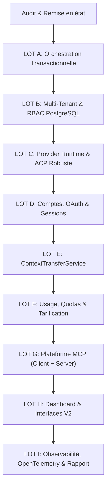

# NEXUS — Agent Runtime & Infrastructure Overhaul
## Audit Initial, Matrice de Conformité et Plan de Migration Stratégique

**Auteur :** Principal Software Architect & Staff AI Agent Infrastructure Engineer  
**Date :** Novembre 2026  
**Dépôt cible :** `https://github.com/adlanehzx/Nexus`  
**Référence concurrentielle :** `https://github.com/pingdotgg/t3code`  
**Statut :** Approuvé pour exécution par lots atomiques  

---

## 1. Contexte et Vision Stratégique

NEXUS est un assistant IA personnel multi-device composé d'un monorepo TypeScript (API Fastify, agent-core, mcp, memory, connections, tools, dashboard), d'un Mission Engine Python asynchrone, d'une persistance PostgreSQL (Prisma 7) et Redis, ainsi que d'extensions client (desktop Tauri, web, mobile, workers).

La fusion initiale issue de T3 Code a introduit les concepts de sessions unifiées, de worktrees VCS et de profils de providers. Cependant, une inspection rigoureuse révèle que plusieurs briques reposaient sur des bouchons, des validations simplifiées à l'excès (`valid: true`), une absence d'isolation multi-tenant stricte et un manque d'infrastructure événementielle transactionnelle.

L'objectif de cet overhaul est d'élever NEXUS au standard de production le plus exigeant, surpassant T3 Code sur :
1. **La fiabilité de l'orchestration :** Architecture transactionnelle outbox/inbox, event sourcing pour les transitions critiques, idempotence stricte, leases distribués avec fencing tokens et réconciliation périodique.
2. **L'isolation multi-tenant :** Modèle hiérarchique `Organization -> Workspace -> Project -> Environments & Roles` avec Row-Level Security (RLS) PostgreSQL, sans rompre l'ergonomie mono-utilisateur (org personnelle automatique).
3. **Le runtime Provider & ACP :** Élimination de tous les faux transports mémoire au profit d'un client ACP typé robuste (JSON-RPC 2.0 / ndjson), négociation de protocole, découverte dynamique de capacités, et intégration des 9 providers clés (Claude Code, Codex, Antigravity, Cursor, Grok, OpenCode, Pi, ACP standard, LLM locaux).
4. **La gestion de comptes et OAuth sécurisée :** Multi-instances d'un même provider, profils isolés, flux OAuth réels (PKCE/Device code), secret references chiffrées sans fuite de clés vers les invites de modèles.
5. **Le transfert de contexte sans perte :** `ContextTransferService` canonique permettant d'alterner les providers sans rupture de cohérence historique ni dépassement des fenêtres de contexte.
6. **Le suivi des quotas et des coûts :** Métriques précises (input, output, cache, reasoning tokens), catalogue tarifaire versionné, indices de confiance (`official`, `provider_reported`, `locally_observed`, `estimated`, `unavailable`).
7. **La plateforme MCP bidirectionnelle :** Non seulement un client MCP sécurisé avec bac à sable et protection SSRF, mais également un **Serveur MCP NEXUS** complet permettant à tout agent externe (Cursor, Windsurf, Claude Code, T3 Code) de piloter NEXUS et ses devices.
8. **Le Dashboard unifié :** Vues professionnelles pour Agents, Quotas & Usage, Hub MCP, Graphe DAG et Gestion Multi-Organisations.

---

## 2. Matrice Différentielle de Conformité

| Sous-système | Statut | Analyse de l'existant | Éléments manquants ou défaillants | Action corrective requise |
| :--- | :---: | :--- | :--- | :--- |
| **Orchestration & Événements** | `PARTIAL` | `AgentOrchestrator` et `AgentLoop` gèrent le cycle de base en mémoire avec un snapshot optionnel en base (`AgentRunSnapshot`). | Absence de Transactional Outbox/Inbox, pas d'Event Sourcing sur les transitions de mission, risque de double exécution ou de perte lors de redémarrage. Absence de leases avec fencing tokens. | **LOT A :** Implémenter `MissionEvent`, `TransactionalOutboxMessage`, `TransactionalInboxMessage`, `ExecutionLease`, projections déterministes et boucle de réconciliation. |
| **Multi-Tenancy & Isolation** | `PARTIAL` | Modèles `Organization`, `OrganizationMembership`, `Team` présents dans `schema.prisma`. | Pas de notion de `Workspace`, `Project`, ni de rattachement systématique des `Missions`, `Agents` et `ProviderAccounts` à un tenant. Risque de fuite inter-organisations. | **LOT B :** Enrichir le schéma Prisma avec `Workspace`, `Project`, `ProviderAccount`, `CredentialReference`, `AuditEvent`. Mettre en place des politiques d'isolation et tests de non-fuite. |
| **Provider Runtime & ACP** | `BROKEN` | `ProviderHub` et `acp-driver.ts` créés lors de la fusion. | `AcpInMemoryTransport` simule artificiellement les tours de dialogue si aucun transport n'est injecté. `validateCredentials()` renvoie `valid: true` sans tester l'API ni vérifier de signature de clé. Seuls 4 drivers existent dans agent-core. | **LOT C :** Supprimer les réponses simulées d'`AcpInMemoryTransport`, implémenter un vrai client ACP typé basé sur `@agentclientprotocol/sdk` (comme dans `services/agent/src/runner.ts`), et ajouter les adaptateurs manquants (Codex, Antigravity, OpenCode, Pi, Local). |
| **Comptes & OAuth** | `PARTIAL` | `ProviderAccountService` gère des profils stockés dans un fichier JSON (`runtime-configuration.json`). | `probeAuth()` valide un compte comme `authenticated` si le dossier `sessionDir` existe sur disque, sans preuve d'authentification valide. Stockage hors base SQL. Pas de flux OAuth réels (PKCE / Device flow). | **LOT D :** Migrer les comptes dans PostgreSQL (`provider_accounts`), interdire la promotion d'état sans preuve, implémenter les flux OAuth et le chiffrement des tokens/secrets. |
| **Transfert de Contexte** | `MISSING` | Seul `t3_worktree_handoff` (fusion git de branche) existe dans `packages/vcs`. | Aucun `ContextTransferService` pour transférer la session d'un provider A vers un provider B en recalculant le budget de tokens, en conservant les artefacts et décisions. | **LOT E :** Créer `ContextTransferService` avec schéma canonique indépendant du provider, compression déterministe, traçabilité et conservation de la provenance. |
| **Quotas, Usage & Coûts** | `PARTIAL` | `quota-forecast.tsx` dans le dashboard lit `remaining5hPercent` calculé par CLI. `BillingUsageRecord` minimaliste par organisation. | Pas d'évaluation fine (cached tokens, reasoning tokens, durée d'exécution). Pas de catalogue tarifaire versionné (`PricingCatalog`). Pas de page `/usage` unifiée ni de niveaux de confiance stricts. | **LOT F :** Créer le `PricingCatalog`, le service de tracking d'usage unifié avec classification de confiance (`official`, `provider_reported`, `locally_observed`, `estimated`, `unavailable`) et la page `/usage`. |
| **Plateforme MCP** | `PARTIAL` | `packages/mcp` contient un bon client MCP (`McpClient`, `McpManager`), un catalogue et bac à sable SSRF. | **Aucun serveur MCP NEXUS** n'existe pour exposer l'assistant à l'extérieur. Pas de persistance SQL des serveurs installés. Pas de support complet MCP Apps. | **LOT G :** Développer le `NexusMcpServer` complet (tools, resources, prompts avec RBAC), persister la configuration MCP et enrichir le catalogue. |
| **Dashboard Unifié** | `PARTIAL` | Nombreuses sections existantes (`overview`, `devices`, `providers`, `vcs-worktrees`, `mission-engine`). | Pas de page unifiée `/usage`, configuration des providers fragmentée, gestion des comptes incomplète, absence de supervision des baux d'exécution et du Hub MCP. | **LOT H :** Harmoniser les sections Dashboard avec les nouveaux contrats (Providers multi-comptes, Usage & Quotas détaillés, Hub MCP, Timeline de mission). |
| **Observabilité & Résilience** | `PARTIAL` | Logs structurés Pino, tracing basique dans API et agent-core. | Manque de corrélation OpenTelemetry de bout en bout (API -> Agent Core -> Subprocess ACP -> MCP -> Workers), pas de circuit breakers sur les drivers de providers. | **LOT I :** Ajouter l'instrumentation OpenTelemetry, circuit breakers sur tous les providers distants, et rédiger le rapport final d'architecture. |

---

## 3. Analyse Approfondie des Vulnérabilités & Faux-Semblants

### 3.1. Bouchon `AcpInMemoryTransport` (`packages/agent-core/src/providers/acp-driver.ts`)
Dans le code actuel :
```typescript
// packages/agent-core/src/providers/acp-driver.ts
export class AcpProviderSession implements ProviderSession {
  constructor(config: ProviderSessionConfig, transport?: AcpTransport) {
    // ...
    this.transport = transport ?? new AcpInMemoryTransport();
  }
}
```
Si aucun transport externe n'est spécifié, la session retombe silencieusement sur `AcpInMemoryTransport`, qui génère un faux flux de texte : `[ACP Server] Processed: ...` sans jamais avertir que le serveur ACP sous-jacent n'est pas démarré.
**Correction :** Le transport en mémoire ne doit être autorisé qu'en environnement de test explicite via injection contrôlée. En production, l'absence de transport valide ou l'échec de raccordement au socket/stdio doit lever une exception typée `AcpConnectionError` et marquer la session comme `failed` ou `disconnected`.

### 3.2. Validation factice dans `validateCredentials()`
Dans `cursor-driver.ts`, `grok-driver.ts` et `acp-driver.ts` :
```typescript
// packages/agent-core/src/providers/acp-driver.ts
async validateCredentials(credentials?: Record<string, string>): Promise<{ valid: boolean; error?: string }> {
  const command = credentials?.command ?? process.env.ACP_COMMAND;
  const key = credentials?.apiKey ?? process.env.ACP_API_KEY;
  if (!command && !key && !process.env.ANTHROPIC_API_KEY) {
    return { valid: true }; // TOUJOURS VRAI !
  }
  return { valid: true };   // TOUJOURS VRAI !
}
```
**Correction :** Remplacement par une validation à preuve réelle :
1. Pour ACP : Tentative d'initialisation (`initialize` handshake) ou vérification de l'exécutable binaire avec `--version` et conformité du protocole.
2. Pour les API HTTP (Anthropic, OpenAI, Cursor, Grok) : Vérification du format de clé, et appel de ping authentifié avec timeout court (3s) ; si le réseau est inaccessible ou si aucune clé n'est fournie, retourner `{ valid: false, error: "..." }`.

### 3.3. Promotion d'état abusive dans `ProviderAccountService.probeAuth()`
Dans `services/api/src/services/provider-accounts.ts` :
```typescript
} else if (existsSync(existing.sessionDir)) {
  authStatus = "authenticated";
}
```
Le simple fait qu'un sous-dossier existe sur la machine de l'utilisateur provoquait l'affichage d'un statut `authenticated` dans le dashboard et le CLI, trompant l'utilisateur et l'orchestrateur.
**Correction :** Interdiction absolue de promouvoir un statut sans preuve vivante. Un compte sans test de requête validé doit rester `unknown` ou `unauthenticated`.

### 3.4. Risque de contournement de la sécurité d'exécution des outils
Dans `UnifiedAgentRuntime`, un callback `toolExecutor` personnalisé était optionnel. S'il n'était pas fourni ou mal câblé, les événements étaient retransmis sans passer par le `ConfirmationService` et `PermissionService` de NEXUS.
**Correction :** Unification du pipeline d'outils au sein d'une couche d'interception inviolable : toute requête d'outil issue d'un stream ACP ou d'un LLM passe obligatoirement par le `ToolSecurityPolicyEvaluator`, qui interroge la hiérarchie de permissions RBAC et le service de confirmation humaine avant toute émission de confirmation au provider.

---

## 4. Plan de Migration par Lots Atomiques Sans Régression

Pour assurer une transformation continue sans jamais casser la suite de tests ou les contrats de l'API, les chantiers sont exécutés par lots séquentiels :



### Ordre d'implémentation :
- **Phase Initiale :** Correction des bouchons et des fausses validations dans `packages/agent-core` et `services/api`.
- **LOT A :** Création du système d'outbox/inbox transactionnelle, gestion des leases avec fencing tokens et moteur de réconciliation dans `packages/agent-core`.
- **LOT B :** Extension du schéma Prisma (`packages/database`), modèles multi-tenant (`Workspace`, `Project`, etc.) et isolation.
- **LOT C :** Implémentation du runtime provider unifié et client ACP typé réel sans mock.
- **LOT D :** Refonte de `ProviderAccountService` avec persistance SQL et flux OAuth.
- **LOT E :** Service de transfert de contexte inter-providers avec conservation de provenance.
- **LOT F :** Service de suivi d'usage, tarification dynamique et route `/usage`.
- **LOT G :** Implémentation du Serveur MCP NEXUS (`packages/mcp`).
- **LOT H :** Intégration et mise à jour des pages du Dashboard (`apps/dashboard`).
- **LOT I :** Instrumentation OpenTelemetry, circuit breakers et validation globale.
