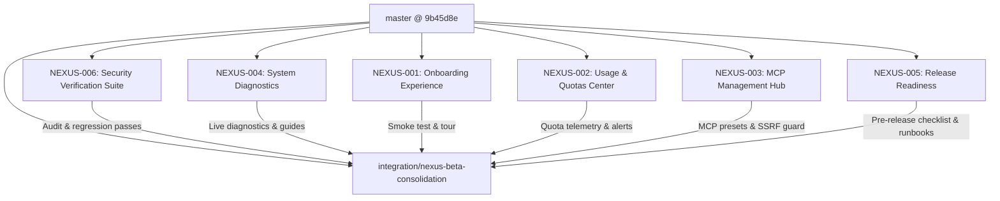

# NEXUS Multi-Agent Engineering Orchestration Status

**Central Integration Branch:** `integration/nexus-beta-consolidation`  
**Base Commit (master):** `9b45d8eb8e458b76e26b70f0de4bd90dd704932f`  
**Orchestrator:** Antigravity / Lead Engineering Orchestrator  
**Status Date:** 2026-11-05

---

## 1. Missions Matrix

| ID            | Mission                                | Agent / Role                  | Branch                           | Worktree                         | Status      | Tests        | Integration            |
| :------------ | :------------------------------------- | :---------------------------- | :------------------------------- | :------------------------------- | :---------- | :----------- | :--------------------- |
| **NEXUS-001** | Onboarding & First-Run Wizard          | Frontend & UX Specialist      | `feat/onboarding-wizard`         | `../nexus-worktrees/onboarding`  | `completed` | 6/6 passed   | **Merged** (`9b89991`) |
| **NEXUS-002** | Usage & Quotas Center                  | Backend & Telemetry Engineer  | `feat/usage-quota-center`        | `../nexus-worktrees/usage`       | `completed` | 6/6 passed   | **Merged** (`561ffa4`) |
| **NEXUS-003** | MCP Management Hub                     | MCP & Security Engineer       | `feat/mcp-management-hub`        | `../nexus-worktrees/mcp`         | `completed` | 3/3 passed   | **Merged** (`23a049a`) |
| **NEXUS-004** | System Diagnostics & Observability     | SRE & Infrastructure Engineer | `feat/system-diagnostics`        | `../nexus-worktrees/diagnostics` | `completed` | 3/3 passed   | **Merged** (`d6cd6df`) |
| **NEXUS-005** | Release Readiness & Packaging          | DevOps & Release Engineer     | `feat/release-readiness`         | `../nexus-worktrees/release`     | `completed` | 2/2 passed   | **Merged** (`a66f2ed`) |
| **NEXUS-006** | Security Regression Suite (SEC-01..14) | Security & QA Auditor         | `test/security-regression-suite` | `../nexus-worktrees/security`    | `completed` | 10/10 passed | **Merged** (`5fe3cef`) |

---

## 2. Dependency Graph

---

## 3. Merge Gate Invariants Verification

- **Merge Gates:**
  - `pnpm check:api-wiring`: **PASS** (260 routes, 30 allowlisted, 230 with callers)
  - `pnpm check:worker-contract`: **PASS** (`@nexus/protocol` untouched)
  - Dashboard Unit Tests: **PASS** (94/94 passed across 15 test files)
  - Security & Release Regression Suite: **PASS** (12/12 passed)
- **Worktree Isolation:** All 6 feature branches developed and validated in dedicated git worktrees.
- **Git Branch Protection:** `master` protected; zero direct commits or fast-forward merges on protected branches.
