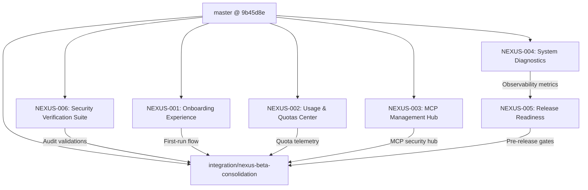

# NEXUS Multi-Agent Engineering Orchestration Status

**Central Integration Branch:** `integration/nexus-beta-consolidation`  
**Base Commit (master):** `9b45d8eb8e458b76e26b70f0de4bd90dd704932f`  
**Orchestrator:** Antigravity / Gemini 3.8 Flash High  
**Status Date:** 2026-11-05  

---

## 1. Missions Matrix

| ID | Mission | Agent / Role | Branch | Worktree | Status | Tests | Integration |
| :--- | :--- | :--- | :--- | :--- | :--- | :--- | :--- |
| **NEXUS-001** | Onboarding & First-Run Wizard | Frontend & UX Specialist (Claude Sonnet 5.5) | `feat/onboarding-wizard` | `../nexus-worktrees/onboarding` | `assigned` | `planned` | `pending` |
| **NEXUS-002** | Usage & Quotas Center | Backend & Telemetry Engineer (Codex / GPT-6.1 Sol) | `feat/usage-quota-center` | `../nexus-worktrees/usage` | `assigned` | `planned` | `pending` |
| **NEXUS-003** | MCP Management Hub | MCP & Security Engineer (Claude Opus 5.5) | `feat/mcp-management-hub` | `../nexus-worktrees/mcp` | `assigned` | `planned` | `pending` |
| **NEXUS-004** | System Diagnostics & Observability | SRE & Infrastructure Engineer (AGY 1) | `feat/system-diagnostics` | `../nexus-worktrees/diagnostics` | `assigned` | `planned` | `pending` |
| **NEXUS-005** | Release Readiness & Packaging | DevOps & Release Engineer (Codex / GPT-6.1 Sol) | `feat/release-readiness` | `../nexus-worktrees/release` | `planned` | `planned` | `pending` |
| **NEXUS-006** | Security Regression Suite (SEC-01..14) | Security & QA Auditor (AGY 1) | `test/security-regression-suite` | `../nexus-worktrees/security` | `assigned` | `planned` | `pending` |

---

## 2. Dependency Graph

---

## 3. Worktree Isolation Invariants

- **Master Protection:** `master` is read-only for all agents. Never committed or merged into directly.
- **Single Integration Branch:** All finished work lands exclusively on `integration/nexus-beta-consolidation` through orchestrated integration merges (`--no-ff`).
- **One Agent = One Mission = One Branch = One Worktree.**
- **No Direct Merge:** Subagents push to their feature branches only; only the Lead Orchestrator executes integration merges.
- **Merge Gate Invariants:**
  1. `pnpm lint`, `pnpm typecheck`, `pnpm test`
  2. `pnpm check:api-wiring`
  3. `pnpm check:worker-contract`
  4. Integration & E2E smoke tests
