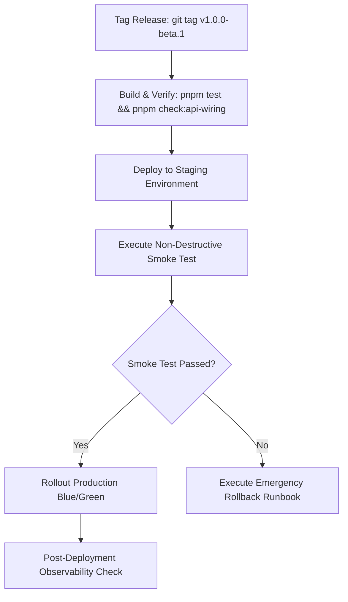

# NEXUS Beta Release Readiness, Deployment & Rollback Runbook

This operational runbook establishes strict release criteria, deployment procedures, database migration safety guarantees, and rollback playbooks for NEXUS private beta releases.

---

## 1. Production Build Targets & Packaging Verification

NEXUS artifacts must pass automated build verification across all production deployment targets:

| Artifact Target      | Technology                      | Packaging Mechanism                             | Verification Command                           | Production Guarantees                                                 |
| -------------------- | ------------------------------- | ----------------------------------------------- | ---------------------------------------------- | --------------------------------------------------------------------- |
| **Core API Service** | Node.js 22 LTS, Fastify, Prisma | Docker Container (`Dockerfile.api`)             | `docker build -f services/api/Dockerfile .`    | Non-root execution, glibc base, secrets via env/vault                 |
| **Worker Engine**    | Node.js / Python Playwright     | Docker Container (`Dockerfile.worker`)          | `docker build -f services/worker/Dockerfile .` | Sandbox isolation, headless Chromium, mTLS/token auth                 |
| **Dashboard UI**     | Vite, React 19, TypeScript      | Static SPA Asset Bundle (`apps/dashboard/dist`) | `pnpm --filter @nexus/dashboard build`         | Content-Security-Policy compliant, zero plain tokens in local storage |
| **NEXUS CLI**        | Node.js Standalone CLI          | Executable npm package (`@nexus/cli`)           | `pnpm --filter @nexus/cli build`               | Autonomous task dispatch, headless pairing, CI/CD integrations        |
| **Desktop App**      | Tauri v2, Rust 1.80+            | AppImage, `.deb`, `.msi`, `.dmg`                | `cargo check` (Linux/macOS/Windows)            | OS Keyring integration (Secret Service, Keychain, DPAPI)              |

---

## 2. Database Migration Safety & Reversibility Protocol

### 2.1 Prisma Schema Migration Invariants

1. **Never drop columns or tables in an active migration** without a 2-phase deprecation cycle.
2. **Column additions must be nullable** or have a deterministic static default value.
3. **Indices must be created concurrently** on high-traffic tables to prevent locking.

### 2.2 Reversible Migration & Full Backup Protocol

> [!CAUTION]
> A schema-only dump (`pg_dump --schema-only`) **NEVER** constitutes a valid backup. Migrations frequently mutate, backfill, or drop table data. All pre-migration snapshots MUST capture complete database state (schema, row data, sequences, indices, and constraints).

Before applying any migration to staging or production:

```bash
# 1. Inspect migration status and drift
pnpm --filter @nexus/database prisma migrate status

# 2. Generate a COMPLETE pre-migration database snapshot (Schema + Full Data)
# Custom compressed format (-Fc) preserves blobs, sequences, and parallel restore capability
pg_dump -Fc --clean --if-exists --no-owner --no-privileges "$DATABASE_URL" > /backup/nexus_db_full_pre_migration_$(date +%Y%m%d_%H%M%S).dump

# Plaintext SQL dump fallback
pg_dump --clean --if-exists --inserts "$DATABASE_URL" > /backup/nexus_db_full_pre_migration.sql

# 3. Apply pending migrations
pnpm --filter @nexus/database prisma migrate deploy

# 4. Verify post-migration database health
pnpm --filter @nexus/database prisma db execute --stdin <<SQL
SELECT 1 FROM "User" LIMIT 1;
SELECT 1 FROM "UsageBucket" LIMIT 1;
SELECT 1 FROM "Device" LIMIT 1;
SQL
```

### 2.3 Comprehensive Rollback Procedure & Restoration Boundaries

If a database migration causes errors or regression:

1. Revert application code container to previous release tag immediately (`NEXUS_IMAGE_TAG=v1.0.x-previous`).
2. Restore complete database state from the pre-migration snapshot:
   ```bash
   # Terminate active backend database connections
   psql "$DATABASE_URL" -c "SELECT pg_terminate_backend(pid) FROM pg_stat_activity WHERE datname = current_database() AND pid <> pg_backend_pid();"

   # Full restoration from compressed binary dump
   pg_restore --clean --if-exists --no-owner --no-privileges -d "$DATABASE_URL" /backup/nexus_db_full_pre_migration_*.dump

   # Alternatively from plain SQL:
   # psql "$DATABASE_URL" < /backup/nexus_db_full_pre_migration.sql

   # Synchronize Prisma migration history metadata
   pnpm --filter @nexus/database prisma migrate resolve --rolled-back "<migration_name>"
   ```

### 2.4 Restoration Boundaries: What Can & Cannot Be Restored

| Asset Category                                                                                 | Restorable via DB Rollback | Recovery Strategy & Invariants                                                                                                                                                          |
| :--------------------------------------------------------------------------------------------- | :------------------------: | :-------------------------------------------------------------------------------------------------------------------------------------------------------------------------------------- |
| **Relational Data** (Users, Devices, Worktree metadata, Tasks, BillingUsage, Quotas)           |          **YES**           | 100% recovered from the `/backup/*.dump` snapshot.                                                                                                                                      |
| **Database Sequences & Relational Constraints**                                                |          **YES**           | Restored by `pg_restore --clean`.                                                                                                                                                       |
| **Worker Ephemeral In-Memory State** (Active WebSocket frames, live step progress)             |           **NO**           | In-flight worker memory cannot be restored. Disconnected workers automatically fail over and pending tasks are re-queued according to REL-04.                                           |
| **Physical Worktree Files on Worker Disks** (`packages/vcs` file trees)                        |           **NO**           | Git worktree directories on physical hosts are detached from PostgreSQL. Rollback scripts must execute `git reset --hard` or prune abandoned worktrees via `pnpm nexus worktree prune`. |
| **External Side-Effects & Third-Party APIs** (LinkedIn posts, external webhooks, email alerts) |           **NO**           | Upstream external actions cannot be rolled back via database restore. Idempotency keys prevent duplicate submission upon restart.                                                       |

---

## 3. Pre-Launch Verification Checklist

Every beta release must satisfy all 16 merge and release gates:

### Security & Isolation

- [x] **SEC-01**: Tenant isolation verified — cross-tenant device/task access strictly rejected (403/404).
- [x] **SEC-02**: Unauthenticated handshake drops connections immediately.
- [x] **SEC-03**: Remote MCP servers enforce SSRF filtering; loopback (`127.0.0.1`), `localhost`, and cloud metadata (`169.254.169.254`) blocked.
- [x] **SEC-04**: Incident logs redact all bearer tokens, GitHub PATs, and OpenAI/Anthropic keys (`sk-`).
- [x] **SEC-05**: Sandboxed host commands prevent directory traversal outside allowed workspace roots.

### Reliability & Observability

- [x] **REL-01**: 4-tier standardized subsystem health matrix (`Healthy`, `Degraded`, `Unavailable`, `Unknown`).
- [x] **REL-02**: Non-destructive diagnostic ping measures round-trip latency (< 200ms).
- [x] **REL-03**: Circuit breakers automatically isolate failing MCP servers after 5 consecutive errors.
- [x] **REL-04**: Worker heartbeat disconnect triggers task re-queueing without data loss.

### Quotas & Telemetry

- [x] **QTA-01**: Telemetry provenance taxonomy strictly separates `official`, `provider_reported`, `locally_observed`, `estimated`, and `unavailable`.
- [x] **QTA-02**: Dynamic countdown timers display exact time remaining until quota resets.
- [x] **QTA-03**: User-customizable quota alert thresholds trigger visual warnings before quota exhaustion.

### User Experience & Onboarding

- [x] **UX-01**: Step-by-step Setup Wizard guides first-run admin initialization and AI provider discovery.
- [x] **UX-02**: Non-destructive interactive Smoke Test Mission validates end-to-end task execution in < 2 seconds.
- [x] **UX-03**: MCP Hub provides one-click presets for Filesystem, Memory Graph, GitHub, PostgreSQL, and Brave Search.
- [x] **UX-04**: Full bilingual localization (English / French) across all dashboard views.

---

## 4. Step-by-Step Deployment Guide



### 4.1 Deployment Execution Commands

```bash
# 1. Pull verified release containers
docker compose -f docker-compose.prod.yml pull

# 2. Run schema migrations
docker compose -f docker-compose.prod.yml run --rm api pnpm --filter @nexus/database prisma migrate deploy

# 3. Perform rolling restart
docker compose -f docker-compose.prod.yml up -d --remove-orphans

# 4. Verify system health
curl -s http://localhost:3000/api/v1/health | jq .
```

---

## 5. Emergency Rollback Runbook

### Trigger Conditions

- System health diagnostic reports `Degraded` or `Unavailable` on Core API or Database for > 60 seconds.
- Smoke test failure after production rollout.
- Unhandled 500 error rate exceeding 1% of total requests.

### Execution Steps

```bash
# 1. Immediately switch container images back to previous stable release
export NEXUS_VERSION=v1.0.0-beta.0
docker compose -f docker-compose.prod.yml up -d --no-deps api worker dashboard

# 2. Notify on-call team and lock new mission dispatches
docker compose -f docker-compose.prod.yml exec api pnpm --filter @nexus/cli nexus maintenance enable

# 3. Validate health of restored instance
curl -s http://localhost:3000/api/v1/health | grep '"status":"ok"'

# 4. Re-enable mission dispatches once health is confirmed
docker compose -f docker-compose.prod.yml exec api pnpm --filter @nexus/cli nexus maintenance disable
```
